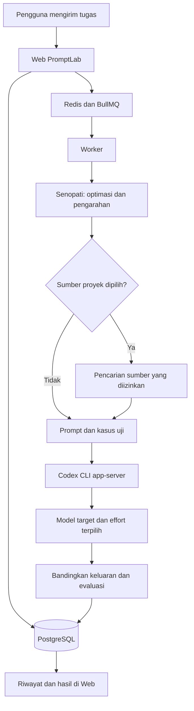

c		f	

# PromptLab

PromptLab adalah aplikasi agentic AI local-first untuk membantu menyusun,
menguji, dan mengevaluasi prompt pada target model Codex yang dipilih pengguna.
Optimasi prompt oleh Senopati menjadi bagian wajib dari alur optimasi. Pengguna
dapat menambahkan sumber pengetahuan proyek agar jawaban memakai konteks yang
terpilih dan dapat ditelusuri.

Setiap instalasi ditujukan untuk satu pengguna pada komputer lokal. Aplikasi
dijalankan dengan Docker Compose dan dibuka melalui `127.0.0.1`.

## Daftar isi

- [Fitur utama](#fitur-utama)
- [Alur agentic AI](#alur-agentic-ai)
- [Knowledge dan GraphRAG](#knowledge-dan-graphrag)
- [Tech stack](#tech-stack)
- [Tools dan integrasi](#tools-dan-integrasi)
- [Instalasi dengan Docker](#instalasi-dengan-docker)
- [Menambahkan folder sumber](#menambahkan-folder-sumber)
- [Workspace tulis opsional](#workspace-tulis-opsional)
- [Menjalankan dan mengelola aplikasi](#menjalankan-dan-mengelola-aplikasi)
- [Mode pengembangan](#mode-pengembangan)
- [Batas penggunaan](#batas-penggunaan)

## Fitur utama

- Optimasi prompt wajib melalui Senopati, termasuk pemeriksaan konteks,
  klarifikasi bila dibutuhkan, pembuatan contoh uji, dan pengembangan kandidat.
- Pengujian prompt acuan dan kandidat pada target Codex yang dipilih.
- Pilihan model dan effort target; pilihan manual pengguna dipakai sebagai
  konfigurasi run. Pilihan otomatis memakai rekomendasi yang tersedia.
- Sumber pengetahuan per proyek, dengan pencarian leksikal, GraphRAG, retrieval
  hybrid, atau konteks sumber penuh.
- Riwayat run yang menyimpan status, tahapan, keluaran, model yang teramati,
  penggunaan provider, dan bukti sumber yang dipakai.
- Evaluasi sumber dan workspace dengan cakupan proyek, izin, dan batas operasi.

## Alur agentic AI



1. Pengguna mengirim tugas, prompt, batasan, serta pilihan target dan sumber.
2. Web menyimpan run. Redis dan BullMQ meneruskan pekerjaan ke worker.
3. Senopati bertindak sebagai optimizer/pengarah: memeriksa kecukupan konteks,
   meminta klarifikasi bila perlu, menyiapkan contoh uji, dan menyusun kandidat
   prompt. Tahapan ini wajib pada flow optimasi.
4. Jika sumber dipilih, worker menyiapkan konteks sesuai strategi retrieval dan
   izin sumber. Bukti sumber diteruskan bersama tugas.
5. Worker memanggil target melalui Codex CLI `app-server` lokal. Model dan effort
   yang dipilih pengguna divalidasi terhadap katalog Codex.
6. Prompt acuan dan kandidat diuji, lalu hasil, jejak run, pemakaian provider,
   dan bukti yang relevan disimpan agar bisa ditinjau di aplikasi.

Alur aplikasi memakai dua peran utama: Senopati untuk optimasi/pengarahan dan
Codex sebagai target eksekusi. Worker menyediakan tool retrieval dan workspace
yang dibatasi; aplikasi tidak membuat subagent eksternal tanpa batas.

## Knowledge dan GraphRAG

Sumber proyek dapat berupa PDF, Markdown, atau teks. PromptLab mengekstrak teks,
membaginya menjadi bagian yang dapat dicari, dan menyimpan indeks serta metadata
di PostgreSQL. Izin dan pilihan sumber menentukan bukti mana yang boleh masuk ke
sebuah run.

Strategi yang tersedia:

- **Leksikal** mencari istilah pada sumber yang dipilih.
- **GraphRAG** menelusuri graph snapshot aktif yang mencakup sumber terpilih.
  Jika snapshot tidak tersedia atau tidak cocok dengan sumber saat ini, sistem
  dapat memakai fallback yang tercatat.
- **Hybrid** menggabungkan pencarian leksikal dan vektor. Ini memerlukan endpoint
  embedding yang sudah dikonfigurasi.
- **Konteks sumber penuh** meneruskan isi sumber terpilih dalam batas konteks.
- **Auto** pada Workspace membiarkan Senopati memilih rute retrieval yang
  tersedia; keputusan dan rute yang dipakai dicatat.

Embedding tidak otomatis aktif pada instalasi baru. Konfigurasikan
`PROMPTLAB_CAMPUS_EMBEDDING_ENDPOINT` dan model yang sesuai sebelum memakai
retrieval hybrid. Template menyediakan nama model awal
`embeddinggemma:latest`, tetapi endpoint-nya dibiarkan kosong.

Konten dokumen diperlakukan sebagai bukti yang tidak tepercaya, bukan instruksi
untuk mengubah kebijakan agent. Pada jalur upload, teks hasil ekstraksi disimpan
di database; byte asli berkas tidak menjadi arsip cadangan PromptLab. Simpan
salinan dokumen asli di tempat yang Anda kendalikan.

## Tech stack

| Bagian         | Teknologi                                                | Tanggung jawab                                       |
| -------------- | -------------------------------------------------------- | ---------------------------------------------------- |
| Web dan API    | Next.js 16, React 19, TypeScript                         | Antarmuka, API, pengaturan, dan riwayat run          |
| Optimasi agent | Paket TypeScript internal                                | Kebijakan optimasi, evaluasi kandidat, dan batas run |
| Provider       | Senopati OpenAI-compatible gateway; Codex CLI app-server | Optimizer dan target model                           |
| Worker         | Node.js 22, BullMQ                                       | Menjalankan pekerjaan agent secara asynchronous      |
| Database       | PostgreSQL 16, pgvector, Drizzle ORM                     | Proyek, prompt, run, sumber, graph, dan embedding    |
| Antrean        | Redis 7                                                  | Antrean dan koordinasi worker                        |
| Packaging      | Dockerfile dan Docker Compose                            | Web, worker, migrasi database, PostgreSQL, dan Redis |

Versi Node dan pnpm yang dipakai proyek tercantum di `package.json` dan
`pnpm-workspace.yaml`. Image Docker memasang Codex CLI versi yang dipatok oleh
`Dockerfile`.

## Tools dan integrasi

### Dipakai oleh aplikasi saat berjalan

- **Senopati** menerima permintaan optimizer melalui gateway chat
  OpenAI-compatible. Gunakan API key dan ID model yang diberikan untuk gateway
  Anda.
- **Codex CLI app-server** berjalan sebagai proses lokal dan menjadi target
  eksekusi. Login Codex dilakukan pengguna dari halaman Pengaturan.
- **Tool retrieval internal** mencari sumber proyek dan verified memory sesuai
  izin serta scope run.
- **Docker Compose, PostgreSQL, dan Redis** menjalankan aplikasi dan menyimpan
  state lokal.
- **Endpoint embedding opsional** dapat menghubungkan model embedding yang
  kompatibel dengan konfigurasi provider. Tidak ada endpoint embedding yang
  otomatis aktif.

### Format dan alat bantu pengembangan

- **Graphify:** PromptLab memiliki adapter untuk mengimpor export graph
  Graphify yang terikat ke sumber. Compose tidak menjalankan Graphify sebagai
  MCP server.
- **Obsidian:** parser Markdown memahami wikilink Obsidian. Aplikasi tidak
  memerlukan Obsidian MCP untuk membaca Markdown yang dipilih.
- **Atlas MCP:** alat bantu pengembangan untuk navigasi kode dan konteks proyek;
  bukan dependency runtime PromptLab.
- **Jev AI:** belum terhubung ke runtime aplikasi dan tidak diperlukan untuk
  instalasi.

## Instalasi dengan Docker

### Prasyarat

- Linux dengan Docker Engine, atau Windows dengan Docker Desktop dan WSL 2.
- Docker Compose CLI v2.2.0 atau lebih baru.
- Bash pada Linux/WSL.
- Koneksi internet saat build pertama untuk mengunduh image dan dependency.

Host tidak memerlukan Node.js, Python, pnpm, atau RTK untuk menjalankan mode
Docker. Jalankan perintah berikut dari root repository.

### Siapkan konfigurasi

```sh
cp .env.container.example .env.container
chmod 600 .env.container
openssl rand -hex 32
```

Salin hasil `openssl` ke `PROMPTLAB_POSTGRES_PASSWORD` di `.env.container`.
Masukkan `PROMPTLAB_CAMPUS_API_KEY` dan `PROMPTLAB_CAMPUS_MODEL` yang berlaku
untuk gateway Anda. Keduanya boleh kosong saat pertama membuka UI, tetapi flow
yang memerlukan Senopati tidak dapat berjalan sebelum provider siap.

Jangan commit `.env` atau `.env.container`; keduanya berisi konfigurasi lokal
dan dapat berisi credential.

### Build dan mulai

```sh
docker compose --env-file .env.container -f compose.yaml up -d --build --wait
```

Buka [http://127.0.0.1:3000](http://127.0.0.1:3000). Untuk Codex, buka **Pengaturan**, pilih
**Login Codex**, lalu ikuti autentikasi di browser. Setiap instalasi Docker
memiliki direktori autentikasi Codex sendiri.

Port default `3000` hanya terikat ke loopback komputer. Jika port itu sudah
dipakai, ubah `PROMPTLAB_WEB_PORT` di `.env.container`.

## Menambahkan folder sumber

Mount sumber ini opsional dan bersifat read-only. Tambahkan konfigurasi ke
`.env.container`:

```dotenv
PROMPTLAB_COLLECTIONS_PATH=/absolute/path/to/selected/sources
PROMPTLAB_LOCAL_WORKSPACE_ROOTS=[{"projectId":"<project-uuid>","rootPath":"/collections"}]
```

Ganti path dan UUID dengan nilai di komputer Anda. Jalankan Compose dengan
overlay sumber:

```sh
docker compose --env-file .env.container -f compose.yaml -f compose.sources.yaml up -d --build --wait
```

Folder hanya terlihat melalui mount yang dipilih. Sebelum membaca file, aplikasi
tetap memerlukan grant baca yang terkait dengan proyek. Mount ini tidak
mengunggah atau membuat backup file asli.

## Workspace tulis opsional

Untuk fitur review patch file, salin template yang dapat dibagikan ke konfigurasi
lokal:

```sh
cp compose.workspace.example.yaml compose.workspace.yaml
```

Atur `PROMPTLAB_WORKSPACE_PATH`, `PROMPTLAB_WORKSPACE_PROJECT_ID`, dan
`PROMPTLAB_WORKSPACE_GROUP_ID` di `.env.container`. Path harus menunjuk ke folder
khusus yang memang Anda izinkan untuk diedit. Setelah menaruh checkout/copy
proyek di folder tersebut, mulai dengan:

```sh
docker compose --env-file .env.container -f compose.yaml -f compose.workspace.yaml up -d --build --wait
```

`compose.workspace.yaml` adalah konfigurasi per mesin dan diabaikan Git.
Workspace ini memberi akses tulis terbatas untuk flow review yang meminta
persetujuan patch; ini bukan akses shell umum atau edit otomatis tanpa izin.

## Menjalankan dan mengelola aplikasi

```sh
# Lihat status layanan
docker compose --env-file .env.container -f compose.yaml ps

# Lihat log web dan worker
docker compose --env-file .env.container -f compose.yaml logs -f web worker

# Hentikan layanan tanpa menghapus volume data
docker compose --env-file .env.container -f compose.yaml stop

# Mulai kembali
docker compose --env-file .env.container -f compose.yaml up -d --wait

# Hapus container dan network, tetap simpan named volumes
docker compose --env-file .env.container -f compose.yaml down
```

Web readiness tersedia di `/api/health/ready`. Pemeriksaan itu mencakup database,
migrasi schema, dan Redis; status provider serta login Codex diperiksa terpisah
dari Pengaturan. `docker compose down -v` menghapus volume database, Redis, dan
autentikasi lokal. Gunakan hanya jika memang ingin menghapus data tersebut.

## Mode pengembangan

Untuk menjalankan web dan worker dari source, gunakan Node.js `22.23.2` dan pnpm
`11.1.3`:

```sh
cp .env.example .env
corepack pnpm install --frozen-lockfile
corepack pnpm dev:stack
```

Mode ini menggunakan Docker untuk service pendukung lokal. Variabel development
tersedia di `.env.example`. `corepack pnpm dev:apps` hanya menjalankan aplikasi
dan worker jika PostgreSQL serta Redis sudah tersedia.

## Batas penggunaan

- PromptLab dirancang untuk satu pengguna lokal; Compose mengikat web ke
  `127.0.0.1`. Jangan mengekspos stack ini ke jaringan publik tanpa desain
  autentikasi dan deployment tersendiri.
- Repository ini menyediakan Docker Compose untuk instance lokal. Belum ada
  workflow GitHub Actions untuk menerbitkan image atau men-deploy ke host.
- Run optimasi memerlukan Senopati dan target Codex yang sudah siap. Health check
  container tidak menguji credential atau mengirim inference provider.
- Sumber yang diunggah disimpan sebagai hasil ekstraksi dan indeks; berkas asli
  perlu disimpan sendiri.
- Simpan backup data penting sebelum upgrade schema. Named volumes bertahan
  setelah `docker compose down` biasa.
