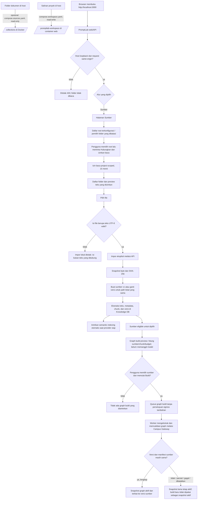
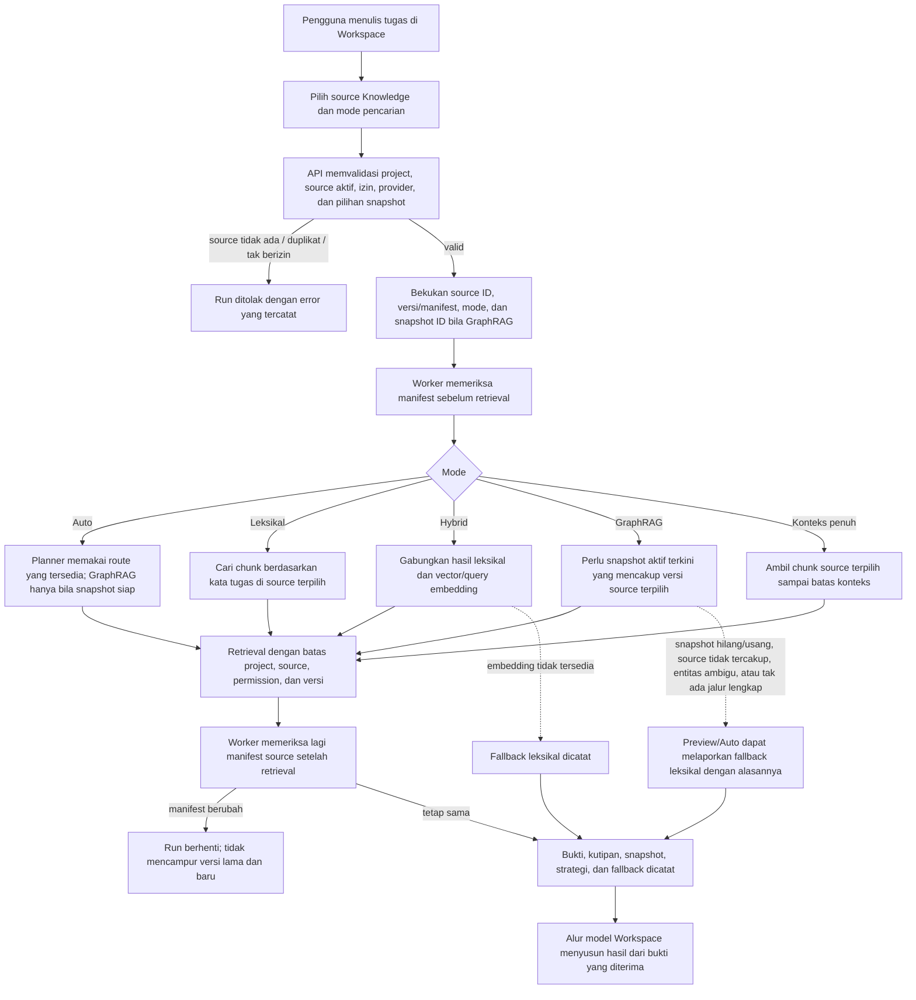
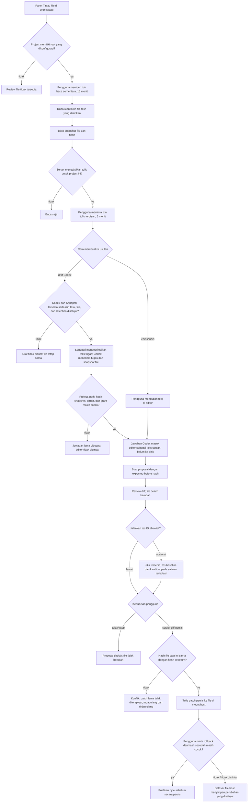

# Alur end-to-end: folder, Knowledge, RAG/GraphRAG, dan edit file

Dokumen ini menggambarkan implementasi PromptLab yang diperiksa pada 19 Oktober 2026. Diagram memisahkan fitur yang berjalan sekarang dari batas dan kondisi gagal yang terlihat di kode. Ini membahas alur folder lokal, sumber knowledge, Workspace chat, serta review perubahan file.

## Model mental singkat

| Istilah | Perannya | Yang perlu diingat |
| --- | --- | --- |
| Folder host | File yang tetap berada di komputer host, lalu dipasang ke container Docker. | Folder itu sendiri belum menjadi Knowledge dan tidak otomatis dibaca. |
| Sumber Knowledge | Salinan versi file yang diimpor ke proyek PromptLab, berikut izin, hash, teks, dan chunk. | Sumber tetap ada setelah izin baca folder berakhir. Perubahan di file asal perlu diimpor ulang. |
| RAG | Cara mengambil potongan bukti dari sumber yang dipilih untuk satu pertanyaan/run. | RAG adalah proses query, bukan folder atau tipe file. |
| GraphRAG | Retrieval yang menelusuri relasi pada snapshot graph yang dibuat dari versi sumber tertentu. | GraphRAG memakai sumber Knowledge yang sama, ditambah indeks graph. Bukan tempat menyimpan file lain. |
| Workspace file review | Membaca salinan proyek yang dipasang ke container, lalu membuat dan meninjau patch. | Codex dapat membuat draf teks bila semua izin diberikan. File baru ditulis setelah pengguna menyetujui diff. |

**Jadi hubungannya:** folder → sumber Knowledge (setelah impor) → RAG saat bertanya. GraphRAG memakai sumber itu juga setelah snapshot graph dibangun. Jalur edit file terpisah dari jalur RAG.

## Folder Docker yang disiapkan

| Folder host | Path di container | Mode | Pemakaian |
| --- | --- | --- | --- |
| `/home/lenovo/PromptLabWorkspace` | `/promptlab-workspace` | Baca/tulis, hanya di container `web` | Salinan proyek yang dapat dibuka dan diedit melalui review patch. Folder ini masih kosong pada pemeriksaan terakhir. |
| Path yang diisi ke `PROMPTLAB_COLLECTIONS_PATH` | `/collections` | Baca saja, `web` dan `worker`, jika `compose.sources.yaml` digunakan | Folder sumber tambahan untuk dipilih dari halaman **Sumber**. Pemilih dibatasi ke mount ini. |

Path di sebelah kiri adalah lokasi host; PromptLab di dalam Docker melihat path sebelah kanan. Browser tidak diberi akses langsung ke seluruh disk. Browser meminta server PromptLab membaca path di dalam mount yang sudah dikonfigurasi. `compose.workspace.yaml` dan `compose.sources.yaml` adalah dua override berbeda; `/collections` tidak tersedia kalau override sumber belum dipasang.

## Diagram 1 — dari folder sampai sumber Knowledge dan snapshot GraphRAG

**Hal yang terjadi saat impor:** file asal tidak diedit oleh indexer. PromptLab membuat snapshot byte dan sumber versi di proyek. Mengimpor ulang path lokal yang sama memperbarui versi sumber itu. Tidak ada sinkronisasi otomatis ketika file host berubah.

Pertahankan ekstensi dan format sumber asli. File kode tetap dikenali sebagai kode oleh Graphify; PDF disimpan bersama snapshot byte dan hanya lapisan teksnya yang diekstrak; file teks lain (termasuk CSV/JSON) saat ini dipotong dan diindeks sebagai teks biasa. Untuk tautan antarcatatan atau konteks naratif, tambahkan sumber Markdown terpisah yang merujuk file asli. Jangan mengubah file biner menjadi `.md` dengan sekadar mengganti nama; gunakan ekstraksi format/OCR terlebih dahulu.

**Snapshot graph:** build menerima sumber eligible yang dipilih pengguna. Semantic indexing otomatis diantrikan saat sumber diimpor. Preview tidak memanggil model; pengguna memulai GraphRAG lewat tombol Build setelah provider terverifikasi dan readiness/budget terpenuhi, tanpa persetujuan egress tambahan. Snapshot mencatat source ID serta versi/hash yang dipakai; perubahan versi setelah build membuat snapshot lama tidak cocok untuk GraphRAG terbaru.

## Diagram 2 — dari pertanyaan Workspace sampai bukti dan jawaban

### Arti mode pencarian di Workspace

| Mode | Yang dilakukan | Jika prasyarat tidak ada |
| --- | --- | --- |
| Auto | Menggunakan route retrieval yang tersedia. GraphRAG hanya menjadi opsi jika snapshot dan source cocok; trace run menunjukkan strategi yang benar-benar dipakai. | Dapat menggunakan pencarian leksikal dengan alasan fallback yang tercatat. |
| Leksikal | Mencari chunk dari source terpilih. Permintaan leksikal eksplisit dapat mencoba istilah tugas jika pencarian semua kata prompt tidak menemukan bukti. | Bisa menghasilkan bukti kosong; jawaban model tanpa bukti Knowledge tidak boleh dianggap terverifikasi oleh sumber. |
| Hybrid | Menggabungkan hasil leksikal dan vector melalui reciprocal-rank fusion. | Jika embedding tidak tersedia, fallback ke leksikal dan alasan fallback dicatat. |
| GraphRAG | Mencari seed entitas lalu menelusuri relasi pada snapshot yang sama dengan versi source terpilih; traversal dibatasi maksimal 2 hop. | Saat membuat run, snapshot yang hilang/usang atau tidak mencakup versi source ditolak. Jika retrieval graph tidak menemukan bukti yang sah, run eksplisit tidak boleh dilaporkan sebagai keberhasilan GraphRAG. |
| Konteks penuh | Mengambil semua chunk dari source terpilih dalam batas konteks. | Teks yang terlalu banyak dipotong sesuai batas; ini bukan penelusuran graph. |

Jika source dipilih untuk run remote, endpoint saat ini mensyaratkan jalur izin Campus Gateway. Source `local-only` tidak boleh ikut dikirim ke sana. Source selection dan manifest versi diperiksa kembali oleh worker sebelum dan sesudah retrieval agar satu jawaban tidak mencampur versi file.

## Diagram 3 — dari file proyek sampai perubahan benar-benar ditulis

**Batas edit saat ini:** Codex bisa membantu menghasilkan draf isi file setelah consent yang diminta UI. Draf masuk ke editor untuk ditinjau. PromptLab tidak memberi model akses shell umum dan tidak menulis hasil Codex langsung ke file. Yang ditulis hanya patch yang terlihat pada diff dan disetujui pengguna.

## Edge case dan tindakan yang terlihat di implementasi

### A. Akses folder dan Docker

| Kondisi | Hasil yang diharapkan | Tindakan |
| --- | --- | --- |
| Workspace dibuka dari deployment remote, alamat LAN, proxy, port/origin tidak cocok | Endpoint folder menolak request; akses lokal memang dibatasi ke loopback dan same-origin. | Buka dari `http://localhost:3000` pada komputer yang menjalankan Docker. Mount host tetap harus dikonfigurasi di Compose. |
| Root host belum di-mount, path salah, atau project ID tidak masuk allowlist | Status root tidak tersedia / project belum dikonfigurasi; tidak ada isi folder yang dibaca. | Periksa path host dan target container di override Compose serta kecocokan project. |
| Pengguna memilih folder di luar picker root | Folder tidak ditawarkan atau token pilihan ditolak; browser tidak dapat mengirim absolute path sekehendaknya. | Mount folder yang memang akan dipakai, lalu pilih lagi di dalam root yang diizinkan. |
| Folder mount kosong | Daftar folder tampil kosong; ini bukan error GraphRAG atau database. | Salin dokumen/project ke folder host. `/home/lenovo/PromptLabWorkspace` masih kosong pada pemeriksaan terakhir. |
| Izin baca belum diminta | Nama root bisa terlihat, tetapi file belum dibaca. | Tekan **Hubungkan dan izinkan baca** atau **Izinkan baca**. Grant berlaku 15 menit. |
| Grant baca kedaluwarsa atau dicabut | List/read/import berikutnya ditolak; preview lama tidak membuat grant tetap berlaku. | Minta grant baru dan buka ulang file. |
| Terlalu banyak grant aktif | Grant baru ditolak sampai grant aktif dicabut/kedaluwarsa. | Cabut izin yang tidak dipakai atau tunggu grant lama berakhir. |
| Path traversal, absolute path, symlink yang keluar dari root, atau hard link | Akses diblokir; path di luar root tidak dibaca atau ditulis. | Gunakan file biasa di dalam folder yang dipasang. |
| File rahasia, internal, tersembunyi, binary, atau terlalu besar | Item dapat disembunyikan, dilewati, atau ditolak oleh operasi baca/search/patch. Hasil list/search dibatasi dan dapat diberi tanda truncation. | Pindahkan hanya file teks yang ingin dipakai; buka subfolder bila daftar dipotong. |
| Web container direstart | Grant dan proposal sementara dapat hilang karena runtime akses lokal disimpan di memori proses. File host dan sumber Knowledge yang sudah tersimpan tetap terpisah dari grant tersebut. | Buka ulang panel, minta izin lagi, dan buat ulang proposal yang belum disetujui. |

### B. Impor Knowledge dan indeks otomatis

| Kondisi | Hasil yang diharapkan | Tindakan |
| --- | --- | --- |
| Database belum tersedia | File lokal masih dapat dipreview, tetapi impor sumber gagal. | Pulihkan koneksi/migrasi database lalu impor ulang. |
| Impor file lokal dengan ekstensi apa pun dan isi teks UTF-8 valid | File dapat diimpor; ekstensi `.md`/`.markdown` disimpan sebagai Markdown, ekstensi lain sebagai teks biasa. | Tetap pastikan isi file memang teks yang ingin dijadikan sumber. |
| File berubah di host setelah pernah diimpor | Sumber Knowledge tetap berisi versi terakhir yang diimpor; tidak ada live sync. | Impor ulang file. Ini menghasilkan versi/checksum baru. |
| Path relatif yang sama diimpor lagi | Sumber lokal yang sama diperbarui, bukan dibuat sebagai link live baru. | Setelah impor ulang, perbarui snapshot GraphRAG sebelum meminta GraphRAG atas versi baru. |
| Sumber legacy berstatus `local_only` | Status tersebut tidak menghalangi semantic indexing atau GraphRAG build yang dipilih pengguna. Workspace chat tetap menjalankan pemeriksaan retrieval yang sudah ada. | Untuk sumber baru, impor otomatis mengantrikan indexing; periksa preview dan kesiapan provider sebelum memulai graph build. |
| Tidak ada source dipilih atau source sudah dihapus/tidak aktif | Tidak ada bukti Knowledge untuk dipakai; API dapat menolak source yang tidak ditemukan. | Buka **Sumber**, aktifkan/impor source yang benar, lalu pilih lagi. |
| Source dipilih dua kali atau pilihan melewati batas | Request ditolak sebagai selection tidak valid. | Pilih source unik sesuai batas UI/API. |
| Provider run tidak menyediakan jalur Campus Gateway saat source dipakai | Run berbasis source ditolak; teks source tidak dikirim ke provider tanpa izin jalur tersebut. | Konfigurasikan dan pilih alur provider yang diizinkan, atau jalankan tanpa source. |

### C. Build dan retrieval GraphRAG/RAG

| Kondisi | Hasil yang diharapkan | Tindakan |
| --- | --- | --- |
| Tidak memilih source untuk build | Preview/enqueue berhenti; build butuh minimal satu source eligible. | Pilih source eligible. |
| Provider belum terverifikasi atau readiness belum terpenuhi | Semantic indexing atau graph build tidak dapat berjalan sampai koneksi/provider siap. | Verifikasi konfigurasi Campus Gateway dan ulangi ketika provider siap. |
| Campus/provider/model tidak tersedia atau budget tidak valid | Enqueue/worker gagal; tidak ada snapshot baru yang diaktifkan. | Perbaiki konfigurasi atau budget, kemudian buat preview/build baru. |
| Build dibatalkan, parsial, gagal, atau manifest berubah saat build | Build baru tidak menjadi snapshot aktif; snapshot aktif sebelumnya dipertahankan. | Tinjau error dan status sumber, lalu jalankan build baru setelah sumber stabil. |
| GraphRAG dipilih tetapi belum ada snapshot aktif | Run eksplisit ditolak sebelum jawaban diproses. | Buat build GraphRAG di halaman **Sumber** dan tunggu status aktif. |
| Source diubah setelah Graph build | Snapshot masih mengikat versi lama dan tidak lagi mencakup versi aktif terbaru. | Rebuild graph dari versi terbaru sebelum memilih GraphRAG. |
| Source terpilih tidak termasuk dalam manifest graph | Run GraphRAG ditolak atau retrieval graph tidak tersedia untuk selection tersebut. | Bangun graph yang mencakup source dan versi yang sama. |
| Entity tidak ditemukan, label ambigu, tidak ada relasi lengkap, atau jalur melewati budget konteks | Graph retrieval tidak memiliki bukti graph yang dapat dipakai. Preview/Auto dapat beralih ke leksikal dengan fallback reason; mode GraphRAG eksplisit tidak boleh ditampilkan sebagai sukses graph. | Periksa preview dan fallback reason; gunakan leksikal/Hybrid atau perbaiki sumber lalu rebuild. |
| Embedding query Hybrid tidak tersedia | Hybrid beralih ke leksikal dan trace mencatat fallback. | Perbaiki koneksi embedding jika butuh Hybrid; untuk saat ini baca hasil leksikal sebagai fallback. |
| Source berubah ketika retrieval sedang berjalan | Pemeriksaan manifest sebelum/sesudah retrieval gagal; run berhenti daripada menggabungkan versi yang berbeda. | Ulangi setelah proses impor/build sumber selesai. |
| Retrieval menemukan nol chunk | Bukti sumber kosong; keluaran tidak bisa disebut terdukung oleh Knowledge. | Periksa source selection dan kata pertanyaan; preview leksikal untuk memastikan kontennya terindeks. |
| Konteks melebihi batas | Retrieval membatasi chunk/path yang dikirim dan mencatat clipping. | Persempit source atau query; jangan anggap semua isi terikut. |

### D. Draf Codex, patch, dan penerapan

| Kondisi | Hasil yang diharapkan | Tindakan |
| --- | --- | --- |
| Project root belum dikonfigurasi | Panel file tidak dapat membaca file. | Pasang root yang dimaksud dan allowlist project di konfigurasi server. |
| Tulis belum diaktifkan untuk project | File dapat dibaca, tetapi tidak ada grant tulis/proposal. | Aktifkan override workspace untuk project yang tepat; izin baca sendiri tidak memberi hak tulis. |
| Grant tulis kedaluwarsa/dicabut | Buat proposal/evaluasi/approve ditolak. Grant tulis saat ini 5 menit. | Minta izin tulis baru dan buka ulang snapshot jika perlu. |
| Codex target atau Senopati optimizer tidak tersedia | Draf Codex tidak dimulai. | Hubungkan dan verifikasi kedua layanan di Pengaturan; atau edit teks sendiri. |
| Consent mengirim tugas ke Senopati, isi file ke Codex, atau menyimpan riwayat belum lengkap | Run draf diblokir. | Beri setiap consent hanya jika setuju dengan tujuan pengiriman/penyimpanan itu. |
| Snapshot file lebih dari 64 KiB atau jawaban Codex lebih dari 128 KiB | Draf tidak dimasukkan ke editor. File tidak berubah. | Ringkas file/pecah tugas menjadi perubahan lebih kecil. |
| Browser tidak mendukung Web Locks, session storage gagal, atau status pengiriman run sebelumnya belum pasti | UI menahan pembuatan run baru untuk mencegah duplikasi. | Pulihkan browser storage/lock lalu periksa status run yang sama sebelum mencoba lagi. |
| File, project, grant, hash snapshot, atau target berubah ketika Codex menjawab | Jawaban lama ditolak dan tidak menimpa editor. | Muat ulang file dan buat draf baru dengan izin/target terbaru. |
| File berubah setelah preview tetapi sebelum proposal atau persetujuan | Hash pembanding gagal; patch lama tidak diterapkan. Editor dapat mempertahankan teks usulan untuk ditinjau ulang. | Muat ulang snapshot, tinjau ulang diff, lalu buat proposal baru. |
| Tes tidak ada/ID tidak di-allowlist/sandbox tidak tersedia | Evaluasi tidak berjalan; tidak ada perintah bebas dari browser. | Gunakan hanya test ID yang disiapkan server. Pengguna masih harus menilai diff sebelum approve. |
| Proposal ditolak atau review ditutup | Isi file tidak berubah. | Buat proposal baru bila masih diperlukan. |
| Persetujuan yang sama dikirim ulang | Approval bersifat idempoten; tidak menerapkan patch kedua kali. | Periksa status patch. |
| Rollback diminta setelah file diedit lagi di luar PromptLab | Hash sesudah tidak cocok; rollback tidak menimpa perubahan yang lebih baru. | Tinjau file saat ini dan buat perubahan pemulihan secara eksplisit. |

## Urutan praktis untuk setup ini

1. Untuk mengedit kode, letakkan checkout/salinan proyek di `/home/lenovo/PromptLabWorkspace`. Di container, panel Workspace membuka `/promptlab-workspace` untuk project yang sudah dikonfigurasi.
2. Untuk menjadikan dokumen sebagai Knowledge, buka **Sumber**, hubungkan root yang tersedia, pilih file teks, tetapkan izin source, lalu tekan **Impor**. Kalau memakai folder host lain, folder itu perlu di-mount; `compose.sources.yaml` memberi contoh root baca-saja `/collections`.
3. Pilih source yang memang boleh dikirim ke Campus Gateway. Sumber itu dapat dipakai untuk pencarian leksikal/Hybrid; GraphRAG perlu langkah build terpisah dan snapshot aktif.
4. Di Workspace, pilih source dan mode pencarian. Baca trace run untuk memastikan strategi aktual dan apakah ada fallback.
5. Untuk edit file, panel **Tinjau file** meminta grant terpisah. Draf Codex, jika dipakai, hanya mengisi editor. Tinjau diff; jalankan tes server-allowlisted bila tersedia; setujui patch secara eksplisit untuk menulis ke file host.

## Rujukan implementasi

- Setup Compose dan batas akses: `docs/CONTAINER_INSTALL.md`, `compose.workspace.yaml`, `compose.sources.yaml`.
- Gate same-origin, root, grant, dan import: `apps/web/src/lib/local-workspace.ts`, `apps/web/src/lib/local-workspace-api.ts`, `apps/web/src/lib/local-workspace-roots-api.ts`, `apps/web/src/components/local-source-browser.tsx`.
- Validasi filesystem dan proposal patch: `packages/tools/src/local-workspace.ts`.
- Sumber, preview/build/retrieval UI: `apps/web/src/components/knowledge-workspace.tsx`, `packages/db/src/knowledge.ts`.
- Validasi run dan source/snapshot selection: `apps/web/src/app/api/projects/[projectId]/runs/route.ts`.
- Retrieval dan fallback: `apps/worker/src/workspace-target-retrieval.ts`, `packages/db/src/graph-retrieval.ts`, `apps/worker/src/main.ts`.
- Graph build dan aktivasi snapshot: `apps/worker/src/graph-build.ts`.
- Draf/edit/review: `apps/web/src/components/local-file-review.tsx`, `apps/web/src/components/codex-file-draft.tsx`, `apps/web/src/lib/codex-file-draft.ts`.
