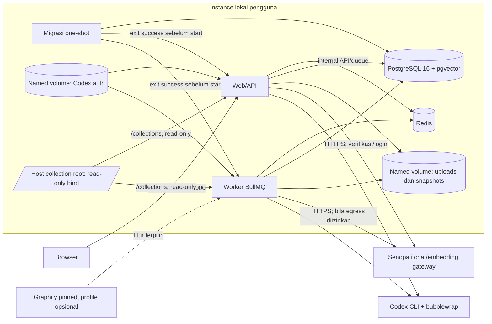

# Rencana end-to-end PromptLab FP PBKK berdasarkan resource aktual

Tanggal: 19 Oktober 2026. Status: **rancangan untuk implementasi berikutnya**.
Pekerjaan pada dokumen ini tidak memasang paket, mengubah runtime, menjalankan
migrasi, atau memulai campaign provider. Nama modul baru dan parameter awal di
bawah adalah usulan, bukan kapabilitas yang sudah berjalan.

## 1. Tujuan dan keputusan yang dipertahankan

Bangun satu lingkungan lokal tempat pengguna memasukkan sumber dan prompt,
Senopati mengoptimalkan prompt serta memilih konteks, Codex menghasilkan jawaban,
dan pengguna dapat memeriksa bukti, penggunaan resource, serta hasil evaluasinya.

Keputusan pengguna yang menjadi dasar:

1. Setiap orang menjalankan instance lokal Compose sendiri dan memakai akses
   providernya sendiri. Web lokal tidak berarti inference Campus bekerja tanpa
   internet. Jalur produk harus dapat dijalankan tanpa Node.js atau Python pada
   host; toolchain host tetap boleh dipakai untuk pengembangan.
2. Setiap prompt produksi wajib melewati optimizer. Hasil optimasi dapat berupa
   kandidat atau no-op beralasan; no-op bukan kegagalan optimizer atau izin
   melewati pengambilan sumber yang sudah dipilih.
3. Model dan effort manual pengguna harus dipatuhi. Auto effort hanya berlaku
   ketika dipilih; rekomendasi Luna memakai `max` jika katalog mendukungnya.
4. Chat produksi tidak menjalankan baseline dan kandidat untuk setiap pertanyaan.
   Perbandingan tersebut tersedia di Pengujian/Experiments.
5. GraphRAG harus menjadi kapabilitas yang benar-benar terbukti. Pengguna tidak
   harus memakai graph untuk setiap pertanyaan.
6. Obsidian dan Graphify harus punya peran konkret dalam flow yang terintegrasi.
   Jev berbayar tetap opsional. Mekanisme memory harus berbukti, bukan hanya
   menyimpan semua respons sebagai fakta.
7. Selesaikan dan validasi satu flow sebelum beralih. Kegagalan atau pemeriksaan
   yang dilewati tidak boleh dilabeli selesai.
8. Runtime yang didistribusikan memakai satu Docker Compose path untuk web,
   worker, database, queue, dan managed data. Hanya web diekspos ke loopback;
   instalasi bukan layanan publik atau multi-tenant.

Rujukan requirement utama: `PromptLab_QA_First_UI_Mockups_v3_with_PRD.zip`,
anggota `PromptLab_QA_UI_v3/PRD.md`, versi 2.1, khususnya §4, §6, dan §7.
Instruksi pengguna terbaru di atas mengungguli perilaku optimasi kondisional
dalam PRD lama. `backups/PRD_PromptLab.md` adalah versi 1.4, bukan PRD terbaru.
File root `PRD (1).md` ternyata berisi PNG dan tidak digunakan sebagai sumber teks.

## 2. Resource dan batas bukti saat ini

| Resource                 | Bukti yang tersedia                                                                                                                     | Keputusan rencana                                                                                                                                      |
| ------------------------ | --------------------------------------------------------------------------------------------------------------------------------------- | ------------------------------------------------------------------------------------------------------------------------------------------------------ |
| Senopati chat            | Adapter `CampusChatProvider` dan riwayat run live; model konfigurasi `qwen3:14b`                                                        | Planner/optimizer utama; jangan menganggap ID lain sudah tersedia                                                                                      |
| Senopati embedding       | Uji langsung sesi ini: `embeddinggemma:latest`, HTTP 200, 768 nilai finite, vector nonzero, L2=1; 11 token; sekitar 1.221 ms            | Provider embedding teks utama                                                                                                                          |
| Identitas EmbeddingGemma | Pengguna memberi metadata parent `embeddinggemma:300m-bf16`, konteks 2.048, 768 dimensi; respons live mengonfirmasi alias, bukan digest | Simpan fingerprint konfigurasi; digest hanya `reported` bila server benar-benar mengembalikannya                                                       |
| Codex lokal              | Adapter app-server mematok Codex CLI `0.160.1`; sandbox memerlukan Linux dan bubblewrap; belum diuji di container                       | Paketkan CLI/bubblewrap pada image runtime, persistent auth home khusus, validasi login/model; jangan melemahkan isolation untuk membuat Compose lulus |
| PostgreSQL 16            | `docker-compose.yml` memakai `postgres:16-alpine`; sudah ada sumber, versi, chunks, graph, trace; belum ada pgvector                    | Pertahankan major 16; pilih image pgvector yang dipin dan kompatibel setelah backup/restore diuji                                                      |
| Redis/BullMQ             | Redis 7 dan BullMQ dipakai; Compose saat ini hanya menjalankan dependency lokal                                                         | Tetap satu queue; runtime Compose memakai network internal dan health gate                                                                             |
| Graphify                 | Adapter impor nyata tersedia; runtime lokal sebelumnya teridentifikasi 0.9.57; belum dipaketkan untuk instalasi Compose                 | Runtime code-only tersedia hanya pada profile fitur yang dipin; jangan membaca graph Atlas development                                                 |
| Obsidian                 | Parsing Markdown/wikilink dan vault locator sudah ada                                                                                   | Vault/folder pilihan pengguna menjadi sumber; sync dan koneksi plugin perlu diselesaikan                                                               |
| Verified memory          | Eligibility, proyeksi runtime, pencarian, scope sumber sudah ada                                                                        | Perluas secara bertahap dan uji causal benefit                                                                                                         |
| GPU lokal sekitar 8 GB   | Kapasitas dari pengguna; tipe GPU dan throughput belum terukur                                                                          | Tidak dibutuhkan untuk embedding Campus; cadangan lokal/vision menjadi fase tambahan                                                                   |
| Compose/distribusi       | Compose saat ini berisi PostgreSQL/Redis; `dev:stack` menjalankan migrasi dan web/worker di host. Tidak ditemukan Dockerfile.           | Jalur full-stack, health/readiness, managed blobs, migrasi terkoordinasi, backup/update, dan instalasi tanpa Node/Python host masih direncanakan       |
| Environment/provider     | `.env.example` berisi URL DB/Redis untuk proses host serta key/model Campus kosong; tidak memuat model embedding.                       | Pertahankan satu file konfigurasi lokal; tambahkan model embedding sebagai field baru, validasi provider lewat backend, jangan bake secret ke image    |

Keberhasilan satu request embedding membuktikan akses dan bentuk respons. Itu
belum membuktikan batch, tokenizer, prompt prefix, batas input, concurrency,
availability berkepanjangan, atau kualitas retrieval Bahasa Indonesia.
EmbeddingGemma **300M** yang diidentifikasi di atas hanya dipakai untuk teks.
Jangan menurunkan kapabilitas dari dokumentasi model lain yang memakai nama
keluarga Gemma/EmbeddingGemma serupa.

## 3. Kondisi kode: reuse dan gap

Atlas mengembalikan graph stale (`20261018T121532-733d32b204cc`) dan tidak ada
curated note yang cocok. Ringkasan ini didasarkan pada pembacaan source yang
relevan, bukan menganggap graph sebagai bukti freshness atau menjalankan ulang
seluruh suite. Graph tidak di-reindex untuk menyusun rencana ini.

| Modul existing                                                                | Pertahankan/reuse                                                             | Gap rencana                                                                                                      |
| ----------------------------------------------------------------------------- | ----------------------------------------------------------------------------- | ---------------------------------------------------------------------------------------------------------------- |
| `packages/providers/src/campus.ts`                                            | Chat, konfigurasi key server, pola timeout/error                              | Belum ada adapter embedding                                                                                      |
| `packages/db/src/knowledge.ts`                                                | Create/replace/version/checksum/permission/readiness                          | Sambungkan status indexing embedding dan invalidation                                                            |
| `packages/db/src/workspace-source-manifest.ts`                                | Frozen selection dan pemeriksaan sumber                                       | Tambahkan binding profil embedding/snapshot bila relevan                                                         |
| `packages/db/src/graph-retrieval.ts`                                          | Lexical, graph, packed context, evidence dan trace                            | Tambahkan jalur vector dan hybrid dengan kontrak hasil yang sama                                                 |
| `apps/worker/src/workspace-target-retrieval.ts`                               | Pemeriksaan manifest sebelum/sesudah; fallback task asli                      | Integrasikan hybrid tanpa menghidupkan lagi bug no-op/retrieval kosong                                           |
| `packages/db/src/knowledge-markdown.ts` dan `knowledge-structure.ts`          | Wikilink, lokasi, resolusi tautan, vault namespace                            | Sync incremental vault dan metadata/anchor tambahan yang diperlukan                                              |
| `packages/db/src/graphify-export.ts` dan `graphify-import.ts`                 | Validasi export, binding sumber, snapshot, review                             | Managed extraction dan pemetaan lokasi otomatis yang diverifikasi                                                |
| `apps/worker/src/workspace-graph-context.ts`                                  | Evidence packing dan `buildWorkspaceTargetInput`                              | Pakai satu jalur untuk seluruh metode retrieval                                                                  |
| `packages/agent/src/index.ts` dan `packages/tools/src/executor.ts`            | Bounded loop, schemas, observations, budget                                   | Routing hybrid dan integration MCP melalui allowlist yang sama                                                   |
| `packages/agent/src/verified-memory.ts` dan worker `verified-memory-tools.ts` | Gate eksperimen, scope, runtime projection                                    | Semantic lookup setelah eligibility, feedback berstatus jelas, ablation                                          |
| `apps/worker/src/optimization-target-selection.ts`                            | Manual/Auto dan katalog live                                                  | Pertahankan satu resolver; jangan membuat policy effort baru di connector                                        |
| Existing controlled evaluation, manifests, monitoring                         | A/R/G, trace, hashes, ledger                                                  | Tambahkan arm hybrid dan telemetry embedding; jangan mengganti evaluator                                         |
| `apps/web/src/app/api/providers/route.ts`, `codex-runtime.ts`                 | Status/verifikasi Campus dan login/katalog Codex                              | Onboarding Compose harus memvalidasi config aktual tanpa mengembalikan secret ke browser                         |
| `apps/web/src/app/api/health/route.ts`, project readiness route               | Liveness sederhana dan readiness sumber per project                           | Tambahkan readiness service Compose/migration/worker; jangan menyamakan liveness dengan siap dipakai             |
| `docker-compose.yml`, `tools/dev-stack.mjs`, `LOCAL_FIRST_ONBOARDING.md`      | PostgreSQL/Redis lokal; web/worker dan migrasi berjalan di host Node/Corepack | Pertahankan sebagai developer path; full Compose image path dan panduan pengguna baru masih baru                 |
| `.env.example`, provider packages                                             | Variable Campus chat server-side; Codex auth app-server                       | Embedding model variable belum ada; Compose runtime path, data root, dan secret lifecycle perlu didokumentasikan |

Catatan penting: impor Graphify saat ini mengikat span ke chunk, tetapi belum
membuktikan label/relasi Graphify benar-benar dinyatakan oleh span itu. Relasi
hasil impor tetap petunjuk navigasi; fakta jawaban harus dibuktikan dari teks
sumber. Detail ada di `../GRAPHIFY_IMPORT.md`.

## 4. Arsitektur target dan batas Compose

Jalur instalasi produk yang diusulkan adalah satu Compose stack per pengguna.
Ini berbeda dari developer path saat ini: `docker-compose.yml` sekarang hanya
menjalankan PostgreSQL dan Redis; `dev:stack` menjalankan migrasi serta web dan
worker pada host. Tidak ditemukan Dockerfile/full-stack Compose. Rincian kondisi
saat ini dicatat di §2–3; desain berikut masih usulan dan belum diuji.

`compose.yaml` menjadi satu entry point produk: satu root Dockerfile memakai
build target bersama untuk web, worker, dan migrasi; Compose menghubungkan
layanan melalui network privat. Developer path yang menjalankan Node di host
tetap tersedia dengan `docker-compose.yml` eksplisit agar tidak berbenturan
dengan Compose default baru.



Target service dan batasnya:

- **Web:** satu port yang dipublish ke `127.0.0.1:3000`. Tidak bind ke
  `0.0.0.0` secara default. `/api/health` saat ini hanya liveness
  sederhana; readiness target harus memeriksa konfigurasi aplikasi/migrasi dan
  dependensi yang dibutuhkan.
- **Worker:** consumer queue tunggal untuk source sync, indexing, retrieval,
  Graphify yang diaktifkan, dan target execution. Tidak mempunyai port host
  publik; heartbeat/job readiness dipantau internal.
- **PostgreSQL:** major 16 dengan image pgvector yang tag/digest-nya dipin
  sesudah kompatibilitas dibuktikan. Tidak publish port di stack produk. Metadata,
  chunks, graph, vector, manifest, dan audit tetap dalam satu database.
- **Redis:** queue existing, dengan healthcheck dan named volume. Status job dan
  evidence durable tetap berada di PostgreSQL.
- **Migrasi:** satu service one-shot menggunakan image/schema yang sama. Tunggu
  PostgreSQL sehat, jalankan migrasi additive satu kali, lalu web/worker mulai
  hanya setelah migrasi exit sukses. Jangan menjalankan migrasi bersamaan dari
  dua app container atau setiap request.
- **Managed blobs dan Codex auth:** named volumes terpisah. Upload originals dan
  snapshots persisten pada blob volume yang dapat dibaca web/worker. Auth home
  Codex per instance terpisah, owner-only (mode 0700), dipakai web untuk
  onboarding dan worker untuk target; jangan bake atau menyalin auth host ke image.
- **Collection root:** host directory yang dikonfigurasi dipasang read-only di
  `/collections` pada web dan worker. Path host tidak tampil sebagai
  filesystem browser. Grant project mengizinkan subpath yang dibatasi oleh mount.
- **Provider egress:** Senopati gateway diakses dari server container dan hanya
  menerima data pada operasi yang disetujui. Embedding memakai layanan remote;
  pengguna tidak memerlukan GPU atau Ollama. Codex CLI `0.160.1` dan bubblewrap
  dipasang/dipatok dalam Linux runtime; jangan memakai `privileged: true`
  atau menonaktifkan sandbox untuk mengatasi kegagalan image.

Image produk dibangun dari root monorepo dengan versi Node 22 dan pnpm 11.1.3
yang cocok dengan manifest. Gunakan satu dependency/build layer bersama agar
web/worker tidak menyimpan definisi dependency yang berbeda. Runtime berjalan
sebagai non-root. Rahasia diberikan runtime dari konfigurasi lokal yang tidak
masuk build args, layer, log, maupun image. Service database/queue tidak
menerima port host pada stack produk. Tidak menambah Kubernetes, inference
service lokal, atau microservice baru.

Compose melakukan healthcheck PostgreSQL/Redis; migrasi menyelesaikan schema;
web menyediakan liveness/readiness service; worker melaporkan readiness setelah
DB/Redis terhubung dan consumer hidup. Provider readiness dipisah dari service
readiness: UI tetap bisa dibuka untuk onboarding ketika credential belum valid,
sedangkan chat produksi baru bisa dijalankan saat optimizer dan target yang
wajib memang siap. Startup tidak menjalankan inference probe secara otomatis.

Dari checkout, setelah Docker Engine/Compose dan konfigurasi onboarding selesai,
jalur target adalah satu perintah `docker compose up -d --build --wait` lalu
buka `http://127.0.0.1:3000`. Untuk release artifact yang sudah berisi image
pin, perintah start tetap satu `docker compose up -d --wait`. Tidak perlu
Node.js atau Python pada host. Build image dapat mengunduh dependencies/base
image; itu berbeda dari inference dan harus terlihat dalam dokumentasi.

Developer path yang ada tetap `corepack pnpm dev:stack`: Node/Corepack ada di
host, Compose menyediakan database/Redis, lalu launcher migrasi dan menjalankan
web/worker di host. Saat Compose product file ditambahkan, launcher harus
memilih `docker-compose.yml` eksplisit. Ini menghindari perubahan arti
perintah developer karena Compose menemukan `compose.yaml` sebagai file
default.

## 5. Flow sumber: masuk, indeks, berubah, dihapus

### 5.1 Folder akses, keanggotaan knowledge, dan penyimpanan

Ada tiga keadaan yang harus berbeda di kontrak dan UI:

1. **Folder terhubung:** pengguna mengizinkan pembacaan suatu root dan memilih
   filter/subfolder. Root dapat berada di lokasi pilihan pengguna yang diakses
   runtime; tidak harus dipindah ke satu folder khusus. Izin root tidak otomatis
   memasukkan seluruh isinya ke knowledge atau mengirimkannya ke Campus.
2. **Sumber terdaftar:** file yang diupload atau termasuk selection/filter
   collection tercatat sebagai source project. Menambah folder sebagai collection
   dapat mendaftarkan seluruh file yang cocok satu kali, tanpa upload per file.
   Exclude secrets, `.git`, dependencies, build artifacts, serta file unsupported.
3. **Sumber terindeks:** versi sumber memiliki readiness lexical, semantic dan
   graph terpisah. Hanya indeks siap yang sesuai versi dan izin dipakai untuk
   metode tersebut. Semua sumber terdaftar tidak otomatis menjadi konteks
   setiap run; selection run tetap eksplisit dan dibekukan.

Collection adalah konfigurasi connector + root/namespace + filter + policy milik
project. Reuse identitas source dan grants existing; jangan membuat source store
lain untuk setiap connector. Akses folder bebas tanpa batas bukan default produk.
Read-on-demand untuk tugas coding tetap dibatasi workspace yang diizinkan dan
ditampilkan di trace. File yang baru dibaca tidak langsung dipromosikan menjadi
persistent knowledge atau memory.

Pada Compose, folder host harus lebih dulu dipasang secara eksplisit sebagai
read-only root backend di `/collections` untuk web dan worker. UX hanya menawarkan
root itu dan subfolder yang bisa dijangkau; ia tidak mengklaim browser dapat
membaca path arbitrer di host. Grant tetap project-scoped dan mencatat subpath
relatif di dalam mount. Jika root belum dipasang, pengguna tetap dapat upload ke
managed storage. Instruksi path Linux, Windows/Docker Desktop, dan WSL harus
dibedakan serta diuji sebelum platform tersebut dinyatakan didukung; jangan
mount seluruh home, drive, atau secrets. Host path dan container path adalah dua
nilai berbeda yang ditampilkan dengan jujur.

Penyimpanan target yang dipilih:

| Jenis data                                             | Lokasi/tanggung jawab                                                                                               |
| ------------------------------------------------------ | ------------------------------------------------------------------------------------------------------------------- |
| File pengguna pada linked folder/vault                 | Tetap di lokasi asal dan tidak diedit oleh indexer                                                                  |
| File hasil upload                                      | Simpan bytes asli pada managed storage lokal aplikasi                                                               |
| Snapshot file yang terdaftar                           | Simpan bytes versi yang diindeks secara content-addressed; upload dapat memakai blob yang sama, bukan salinan kedua |
| Teks hasil ekstraksi, chunk, metadata, checksum, versi | PostgreSQL existing                                                                                                 |
| Vector 768d, profil embedding, status indexing         | PostgreSQL + pgvector                                                                                               |
| Entity/relation, source bindings, graph snapshot       | Tabel graph PostgreSQL existing                                                                                     |
| Trace dan experiment/memory provenance                 | DB dan export audit existing sesuai retention                                                                       |

Path blob konseptual: `data/<projectId>/blobs/<sha256>`; lokasi data sebenarnya
ditetapkan saat implementasi dan dipersist bersama DB. Snapshot mengarsipkan
hanya file yang dipilih/didaftarkan, bukan seluruh drive. Bytes asli dan teks
ekstraksi berbeda: PDF harus tetap bisa diperiksa walaupun parsing mengubah
layout. Semua embedding/graph adalah indeks turunan; tidak menggantikan dokumen.
Raw blob storage ini masih NEW; source saat ini menyimpan extracted chunks dan
metadata, sehingga jangan mengklaim file upload asli sudah diarsipkan utuh.

Untuk linked sources, file asal menentukan versi terbaru setelah sinkronisasi;
snapshot immutable menentukan bukti versi yang benar-benar dipakai run.
Watcher hanya pemicu: startup, reconnect dan sebelum run harus memeriksa
freshness sesuai izin akses, termasuk checksum sumber terpilih. Jika tidak bisa
memverifikasi sumber yang terhubung, tandai freshness unknown dan minta
reconnect atau pilihan eksplisit memakai snapshot arsip; jangan menyatakan live.

Temporary read grant existing dan imported source permission berbeda.
Kedaluwarsa grant menghentikan pembacaan folder; itu tidak otomatis menghapus
snapshot yang sebelumnya diimpor. UI harus membedakan putus sinkronisasi,
nonaktifkan sumber dari retrieval, dan hapus data/arsip. Revocation source
permission tetap langsung mengecualikan evidence terkait.

### 5.2 Kapan embedding dan graph dibangun

Default adalah **index-on-registration/update**, asynchronous. Setelah file
diupload atau terdeteksi pada linked collection, pipeline menyimpan versi dan
melakukan parsing/chunking. Lexical index dibangun lokal dan tidak memerlukan
Campus egress. Semantic index mengirim chunk ke Senopati hanya bila egress
diizinkan untuk koleksi tersebut dan pengguna menyetujuinya. Izin koleksi dan
mode graph disetujui saat setup; tidak perlu meminta izin yang sama pada setiap
query.

Ini memisahkan lokasi komputasi indeks dari egress evidence. `local_only` dapat
mendukung parse, lexical index, dan preview lokal, tetapi tidak mengizinkan teks
sumber dikirim ke optimizer remote, embedding, ekstraksi graph semantik, atau
target. Fallback ke lexical hanya mengubah metode retrieval; fallback tidak
mengubah izin sumber. Untuk run remote berbasis sumber, gunakan hanya sumber
terpilih yang memenuhi workflow izin existing. Lihat [keputusan kontrak Flow 0](./FLOW0_KNOWLEDGE_CONTRACT_DECISIONS_20261019.md).

Graphify code-only disiapkan dari kode terpilih; tautan Obsidian dibaca dari
notes terpilih. Ekstraksi graph semantik dokumen memakai sumber graph-enabled
yang diizinkan, setelah preview resource. Graph extraction LLM tidak otomatis
dijalankan pada seluruh drive atau semua file yang dapat dibaca. Ketiga jalur
mengikat versi sumber yang sama dan mencatat readiness masing-masing.

Saat bertanya, normalnya hanya query baru yang di-embed. Dokumen tidak di-embed
ulang kecuali isi/profil/preprocessing berubah. Bila semantic/graph indexing
belum siap, Auto dapat memakai lexical dengan status eksplisit hanya untuk
sumber terpilih yang izinnya berlaku bagi alur evidence remote tersebut.
Lexical source `local_only` tetap untuk indexing/preview lokal dan tidak menjadi
eligible bagi optimizer atau target remote. Permintaan yang mensyaratkan
semantic/graph menunggu job atau berhenti dengan status belum siap. Jangan
membuat graph/index penuh secara tersembunyi ketika target sedang menghasilkan
jawaban. Lazy indexing untuk korpus sangat besar menjadi opsi lanjutan, bukan
perilaku default yang berbeda-beda tanpa penjelasan. Lihat [keputusan kontrak
Flow 0](./FLOW0_KNOWLEDGE_CONTRACT_DECISIONS_20261019.md).

### 5.3 Urutan ingestion dan pembaruan

1. Pengguna memilih project dan sumber: upload, root folder, atau vault. Tampilkan
   sumber yang akan dibaca dan izin mengirim isinya ke Campus untuk embedding
   atau ekstraksi graph. Jangan mengindeks seluruh mesin atau vault Atlas.
2. Adapter membaca sumber dalam root yang diizinkan. Simpan identitas stabil,
   path relatif, checksum, tipe, versi, serta metadata. Untuk Obsidian: simpan
   vault namespace, frontmatter/alias yang relevan, heading, block anchor,
   wikilink dan backlink hasil resolusi.
3. Reuse lifecycle sumber existing. Chunk mengikuti struktur heading/fungsi,
   bukan hanya potongan karakter. Parameter awal: sekitar 300–500 token dengan
   overlap sekitar 50; tunduk pada hasil evaluasi dan batas aktual 2.048 token
   termasuk prefix. Jangan memotong blok kode/negasi/syarat penting secara buta.
4. Pisahkan pencacahan token model dari estimasi context budget existing.
   Tetapkan tokenizer yang cocok dan versioned; bila tidak tersedia, tandai
   estimasi dan tangani penolakan input panjang secara eksplisit. Jangan
   mengklaim batas 2.048 sudah aman hanya dari hitungan karakter.
5. Queue job mengirim chunk ke endpoint embedding. Uji dahulu kontrak batch dan
   prompt query/document model. Mulai serial; concurrency/batch dinaikkan hanya
   jika capability dan telemetry mendukungnya. Panggilan tidak ditahan di dalam
   transaksi DB yang panjang.
6. Validasi respons: jumlah item/order/index, 768 dimensi, finite, nonzero, model
   dan usage bila dilaporkan. Simpan hasil hanya bila source version/permission
   masih berlaku saat commit; request lama tidak boleh mengaktifkan versi baru.
7. Untuk kode, jalankan Graphify code-only pada snapshot folder yang disetujui.
   Reuse importer untuk graph/snapshot. Binding node/edge harus cocok dengan
   file, lokasi, chunk, checksum, dan teks; binding yang meragukan ditandai
   unmapped/review, tidak diberi span asal-asalan.
8. Untuk dokumen, gabungkan tautan Obsidian dan ekstraksi entitas/relasi Senopati
   existing hanya jika diizinkan. Tidak perlu menjalankan Graphify LLM extraction
   dan native graph extraction untuk isi dokumen yang sama secara otomatis.
9. Tampilkan readiness terpisah: sumber tersedia, lexical siap, semantic siap,
   graph siap/stale, jumlah job gagal. Kegagalan sebagian bukan `ready` penuh.
10. Perubahan sumber menjadwalkan hanya chunk yang berubah. Penghapusan atau
    pencabutan izin segera mengecualikan sumber dari retrieval, graph, cache,
    dan memory terkait; audit versi lama tetap disimpan sesuai retention.

**Profil embedding:** simpan provider, model ID yang diminta/dilaporkan, digest
bila tersedia, dimensi, query/document prefix version, tokenizer/chunker version,
dan generation profil. Alias `latest` dapat berubah tanpa berganti nama;
perubahan yang terdeteksi harus membentuk profil baru dan reindex. Jika digest
tidak disediakan, catat unknown, lakukan canary checks dan invalidasi konservatif.
Jangan menjanjikan deteksi model drift sempurna dari nama alias saja.

Cache vector memakai project/scope, normalized input hash, profil dan versi
preprocessing. Lookup cache tetap harus memeriksa izin terkini. Vector dari
profil/model berbeda tidak boleh dicampur meskipun sama-sama 768 dimensi.

Folder catatan turunan/compiled wiki boleh menyimpan ringkasan, keputusan dan
tautan hasil proses agar manusia mudah menavigasi pengetahuan. Setiap catatan
turunan harus menyimpan lineage ke sumber aslinya dan status draft/reviewed.
Ringkasan dan dokumen asal tidak dihitung sebagai dua bukti independen; dedup
berdasarkan lineage mencegah skor retrieval membesar karena duplikasi ekspor.

## 6. Flow prompt produksi dari awal sampai jawaban

1. **Bekukan intent:** prompt asli, constraints, sumber terpilih, model/effort,
   versi policy, serta source/workspace manifest. Validasi capability target.
2. **Memory prefetch:** reuse satu pencarian runtime memory yang dibatasi dan
   evidence-bound. Jangan memasukkan evaluator export/holdout ke optimizer.
3. **Mandatory optimizer:** Senopati menerima task, constraints, status indeks,
   ringkasan memory dan tool allowlist. Ia mengeluarkan structured decision:
   klarifikasi, tool request, kandidat, atau no-op. Tidak langsung menjawab
   sebagai pengganti target.
4. **Tools retrieval:** jika dibutuhkan, host melakukan lexical dan semantic,
   menggabungkan ranking, lalu graph expansion sesuai keputusan/policy.
   Embedding task/query dihitung sekali per query yang memang berbeda dan
   direuse; optimasi prompt tidak otomatis memicu embedding ulang semua sumber.
5. **Observe lalu adapt:** hasil tool dikirim ke giliran keputusan berikutnya.
   Bila bukti kurang, agent boleh memperbaiki query atau mengambil detail sumber
   dalam budget. Jika tidak cukup, klarifikasi atau jawab batas pengetahuan;
   jangan menganggap semua hasil semantic relevan.
6. **Bangun kandidat:** pertahankan angka, negasi, format, bahasa, entitas,
   permission dan user intent. Senopati boleh merapikan instruksi; tidak boleh
   menambah fakta yang tidak ditemukan atau mengganti pilihan model manual.
7. **Host gate:** schema, invariant kritis, manifest freshness, provenance dan
   context budget diperiksa. Revisi sebelum target harus eksplisit dan terbatas;
   Workspace saat ini `maxRevisions=0`, sehingga mengizinkan satu revisi adalah
   perubahan terencana, bukan fitur yang dianggap sudah aktif.
8. **Buat evidence pack tunggal:** reuse packer existing. Teks yang dikirim ke
   target mempunyai source/version/chunk/quote/hash; graph path terhubung ke
   bukti yang sama. No-op tetap wajib mengambil sumber yang dipilih. Hasil
   planner kosong tetap memberi kesempatan fallback task asli yang sudah ada.
9. **Jalankan satu target turn:** gunakan kandidat atau prompt asli bila no-op,
   model/effort final dan evidence. Tidak menjalankan baseline otomatis. Satu
   target turn dapat berisi tool execution terkontrol pada mode coding sesuai
   kontraknya; jangan menyamakannya dengan jaminan satu inference internal.
10. **Validasi dan tampilkan:** schema/output constraint, citation validity,
    source support checks yang tersedia, jawaban, sumber, strategi, overhead,
    status verifikasi. Jika salah, tampilkan hasil gagal/unknown; jangan membuat
    jawaban target baru diam-diam untuk menyembunyikan kegagalan.
11. **Feedback:** simpan outcome run. Hanya jalur eligibility yang sah dapat
    menghasilkan memory terverifikasi. Respons biasa bukan training model.

Tanpa ground truth, sistem dapat memeriksa format, scope, constraint dan dukungan
sumber; ia tidak dapat memastikan jawaban paling benar atau lebih baik dari
baseline yang tidak dijalankan. Label runtime adalah **belum dibandingkan**,
**lolos validator tertentu**, atau **didukung sumber**, sesuai bukti. Confidence
model, cosine similarity, dan thumbs-up tidak setara dengan kebenaran universal.

## 7. Routing, retrieval dan trade-off yang eksplisit

| Kondisi                                        | Jalur                            | Aturan                                                                                                                                                 |
| ---------------------------------------------- | -------------------------------- | ------------------------------------------------------------------------------------------------------------------------------------------------------ |
| Tidak ada sumber dipilih; tugas mandiri        | Tanpa source retrieval           | Optimizer tetap wajib; jangan mencari di sumber lain diam-diam                                                                                         |
| Sumber dipilih; identifier/nilai eksak dominan | Lexical + semantic bila siap     | Exact match dipertahankan; semantic membantu parafrasa                                                                                                 |
| QA dokumen/parafrasa Bahasa Indonesia          | Hybrid lexical + semantic        | Ranking gabungan; selalu citation ke sumber                                                                                                            |
| Dependency, relasi, dampak, multi-hop          | Hybrid seeds + graph expansion   | Maksimal dua hop awal; arah, negasi, tanggal, versi harus dipertahankan                                                                                |
| Istilah atau tujuan substantif ambigu          | Klarifikasi                      | Jangan memilih definisi domain tanpa bukti                                                                                                             |
| User memilih lexical/graph secara eksplisit    | Patuhi pilihan                   | Jangan mengganti strategi tanpa mencatat dan persetujuan perubahan yang relevan                                                                        |
| Auto tetapi embedding/graph tidak tersedia     | Lexical jika layak dan diizinkan | Tampilkan alasan fallback; lexical tidak mengubah izin; no-match berakhir unknown/abstain ([Flow 0](./FLOW0_KNOWLEDGE_CONTRACT_DECISIONS_20261019.md)) |
| Graph wajib di eksperimen G                    | Graph atau gagal/unsupported     | Fallback lexical tidak dihitung sebagai keberhasilan G                                                                                                 |

Host lebih dulu membatasi pilihan berdasarkan izin, readiness, mode dan budget.
Senopati memilih langkah di dalam ruang tersebut dan melihat hasil tools.
Heuristik kata seperti "hubungan" hanya petunjuk awal, bukan router satu-satunya.
Setiap keputusan menyimpan reason code, versi policy, requested/used strategy,
fallback reason, dan tindakan selanjutnya.

Parameter awal yang diuji, bukan angka final: top-10 lexical + top-10 semantic,
dedup menurut chunk/source, Reciprocal Rank Fusion (RRF), lalu pilih sekitar
5–8 chunk dalam batas context existing. Jangan menjumlah skor lexical dan cosine
mentah. Kemiripan cosine tidak memakai satu threshold universal yang diklaim
menentukan kebenaran; threshold relevance dipilih pada development set.

Graph expansion reuse batas existing: maksimal dua seeds, dua hop, 30 node,
60 edge, tiga path, sekitar 3.000 estimated context tokens. Graph build existing
memiliki batas 120 chunk; pilot harus menghormatinya dan readiness menjelaskannya.
Scale-up menjadi perubahan terpisah bila benar-benar dibutuhkan.

Chat normal mempertahankan satu target turn. Sebagai pola penggunaan, kasus
tanpa tools sering cukup satu optimizer call; kasus retrieval biasanya memerlukan
planner → tool → observation → keputusan berikutnya. Itu pola, bukan plafon
provider dua kali. Tetap gunakan ledger dan batas existing sampai diuji:
Workspace maksimal lima decision turns, delapan tool calls, 180 detik.
Jangan menghilangkan kontrol deadline atau retry tanpa batas.

Efisiensi diukur seluruh workflow: embedding indexing, query embedding,
optimizer, target, tool, retry, dan evaluator bila ada. Cache embedding dan
incremental indexing memberi manfaat tanpa melewati optimizer wajib. Result
cache bukan default; jika kelak dipakai, harus mempertahankan semantics
mandatory optimization dan mengikat seluruh dependency serta consent.

## 8. Memory: implementasi yang dimaksud dan batasnya

**Pilihan:** lanjutkan verified memory internal dengan konsep memory selektif,
bukan menginstal library bernama Jev-Mem yang identitas dan kontraknya belum
dikunci. Repo `reliable-era/andrej-karpathy-skills-jev` menggunakan TypeSafe Jev,
yaitu layanan decision/judge; itu berbeda dari store memory.

Empat jenis data dipisahkan lewat kontrak/status di modul existing:

- Working memory: plan dan observation run yang sedang berjalan.
- Project knowledge: dokumen dan graph berversi; klaim sumber belum tentu benar.
- Preference memory: pilihan eksplisit pengguna dengan scope dan provenance.
- Episodic optimization memory: task family, strategi, constraints, outcome,
  konfigurasi/evidence eksperimen dan validitas sumber.

Reuse eligibility existing untuk istilah `verified`: acceptance eksperimen,
evidence terikat, source manifest masih valid, dan runtime projection yang aman.
Feedback chat dapat disimpan sebagai feedback/candidate; jangan mengubahnya
langsung menjadi verified memory. Pengguna dapat menolak atau mencabut memory.

Semantic memory search, jika diperlukan, bekerja atas kandidat yang sudah lolos
eligibility dan project scope. Ranking tidak menghapus pemeriksaan freshness.
Simpan ringkasan yang membantu strategi, bukan seluruh history, holdout answer,
private reasoning, atau credential. Ekspor Markdown ke Obsidian mempertahankan
ID/checksum/status dan reference ke sumber; catatan turunan bukan otoritas baru.

Paid Jev dapat menjadi adapter scorer/judge opsional dengan toggle default off,
schema input/output dan fallback yang jelas. Senopati dapat memberi penilaian
terstruktur tetapi confidence-nya tidak diklaim terkalibrasi atau setara Jev.
Penambahan layanan ini baru layak setelah ablation menunjukkan gain.

## 9. Peran MCP, Graphify dan Obsidian yang konkret

| Koneksi             | Pilihan                                                                | Deliverable dan batas                                                                                                                  |
| ------------------- | ---------------------------------------------------------------------- | -------------------------------------------------------------------------------------------------------------------------------------- |
| Graphify extraction | Managed CLI code-only pada snapshot project                            | Graph nyata → mapping lokasi → importer existing → graph DB berversi                                                                   |
| Graphify MCP        | Bridge worker read-only; spike protokol sebelum fitur UI               | Allowlist query/node/neighbor/path/status yang ditemukan pada versi server; output menjadi petunjuk lalu di-resolve ke source evidence |
| Obsidian dasar      | Folder/vault adapter                                                   | Tidak memerlukan Obsidian terbuka; sinkronisasi checksum dan tautan                                                                    |
| Obsidian MCP        | Plugin community Local REST API with MCP jika pengguna mengaktifkannya | Worker hanya list/read/search/metadata; update/delete/command tidak diberikan ke model                                                 |
| Dokumentasi library | Context7 opsional untuk tugas kode                                     | Konteks eksternal terpisah, source URL/time; tidak mengunggah rahasia/proyek sebagai query                                             |
| Jev/layanan lain    | Tidak menjadi dependensi wajib                                         | Tambahkan hanya dengan kebutuhan dan evaluasi yang jelas                                                                               |

MCP client ditempatkan di worker melalui satu bridge pada boundary tools existing.
Katalog tools berasal dari handshake/list tools dan versi server, bukan nama
yang diasumsikan. Project path/namespace dan izin diisi server. Graphify 0.9.57
menerima `project_path`; bridge tidak boleh membiarkan model memilih proyek lain.
Gunakan hasil direct adapter dan MCP melalui normalization/packer yang sama,
bukan membuat graph atau sumber kedua yang tidak sinkron.

Obsidian plugin adalah pihak ketiga dan menyediakan operasi write/command selain
read. Allowlist harus ditegakkan host, dengan endpoint/certificate/key tersimpan
server-side. Koneksi WSL ↔ Obsidian Windows memerlukan pemetaan host yang diuji;
`127.0.0.1` tidak selalu menunjuk proses yang sama di kedua lingkungan. Jangan
mengatasi masalah koneksi dengan bind publik atau mematikan pemeriksaan TLS global.

Direct dan MCP connector masing-masing memakai identity locator sumber yang
sama. Mode koneksi dipilih per vault agar satu note tidak diingest dua kali.
Event plugin membantu perubahan cepat; startup/reconnect tetap melakukan
reconciliation karena event yang terlewat bukan bukti folder tidak berubah.

MCP berguna untuk interoperabilitas, bukan peningkatan semantic retrieval
otomatis. Flow semantic tidak bergantung pada memasang semua MCP tersebut.

## 10. Struktur kode yang diusulkan

Tambahkan modul hanya ketika flow terkait dikerjakan. Nama berikut adalah
batas tanggung jawab, bukan kewajiban membuat setiap file di awal.

```text
packages/contracts/src/
  index.ts                        # perluas schema existing
packages/providers/src/
  campus.ts                       # chat existing
  campus-embedding.ts              # NEW: endpoint embedding, schema, timeout
packages/db/src/
  knowledge.ts                    # lifecycle existing
  knowledge-markdown.ts            # parser existing
  knowledge-structure.ts           # link resolution existing
  chunk-embeddings.ts              # NEW: storage/status/lookup vector
  hybrid-retrieval.ts              # NEW: ranking/fusion; tanpa HTTP provider
  graph-retrieval.ts               # kontrak retrieval/evidence existing
  graphify-import.ts               # importer existing
packages/agent/src/
  index.ts                        # controller existing
  retrieval-policy.ts              # NEW bila policy cukup kompleks untuk dibagi
  verified-memory.ts              # eligibility existing
packages/tools/src/
  executor.ts                     # satu enforcement scope/budget
  mcp-bridge.ts                    # NEW setelah spike; transport + allowlist
apps/worker/src/
  embedding-index.ts               # NEW: queue worker, retry, commit guards
  knowledge-source-sync.ts         # NEW: folder/vault incremental adapter
  graphify-adapter.ts              # NEW: managed extraction dan mapping
  workspace-target-retrieval.ts    # orchestration existing diperluas
  workspace-graph-context.ts       # satu evidence packer existing
  verified-memory-tools.ts         # handler existing
  main.ts                         # wiring, bukan tempat seluruh logika baru
```

Boundary dependency: DB tidak menghubungi provider. Worker memanggil adapter
embedding kemudian menyerahkan vector dan profil kepada fungsi retrieval DB.
Pencarian preview UI diproses dengan coordinator/job yang sama; jangan menyalin
logika retrieval ke route web. Helper transport kecil yang benar-benar sama
dapat direuse dari provider existing; jangan membuat framework provider baru
untuk dua endpoint yang berbeda.

Data baru minimum: profil embedding, embedding per chunk, dan status job yang
durable. Reuse job/run event dan source version existing bila kontraknya cukup.
Key vector harus mengikat project, version/chunk, profile, input checksum dan
preprocessing. Simpan `vector(768)` untuk profil ini; model berdimensi lain kelak
memerlukan migrasi/storage terpisah. Jangan menambah schema generik multimodal
sebelum input visual benar-benar menjadi flow.

Mulai exact cosine search yang di-filter project/source/version, dengan indeks
filter biasa. HNSW baru ditambah bila latency corpus representatif memerlukannya;
periksa recall setelah filter dan opsi iterative scan. Ini mencegah kompleksitas
ANN dan penurunan recall sebelum ada kebutuhan.

## 11. Urutan eksekusi modular dan checklist per flow

Flow 0–7 adalah backlog yang diusulkan, bukan laporan pekerjaan yang sudah
selesai. Flow 0–6 mempertahankan urutan topik roadmap; tabel berikut menjelaskan
dependency sebenarnya agar urutan daftar tidak membuat keterkaitan palsu.

| Flow                                  | Prasyarat/dependency                                         | Catatan urutan                                                                           |
| ------------------------------------- | ------------------------------------------------------------ | ---------------------------------------------------------------------------------------- |
| 0 — Kontrak dan fixture               | Requirement pengguna dan PRD yang dirujuk di §1              | Selesaikan sebelum perubahan runtime.                                                    |
| 1 — Retrieval hybrid satu sumber      | Gate Flow 0                                                  | Slice pertama yang menguji ingestion sampai jawaban.                                     |
| 2 — Vault Obsidian                    | Gate Flow 1                                                  | Default dikerjakan berikutnya; memakai lifecycle sumber yang sama.                       |
| 3 — Graphify dan relational QA        | Gate Flow 1                                                  | Flow 2 tidak wajib. Mulai setelah retrieval dasar lulus.                                 |
| 4 — MCP connector                     | Flow 2 dan/atau 3 sesuai connector yang dipilih              | Opsional berdasarkan kebutuhan interoperabilitas; bukan prasyarat Flow 5.                |
| 5 — Memory dan adaptasi agent         | Flow 1 dan 3 untuk ablation hybrid+graph                     | Tidak bergantung pada pemasangan MCP atau Obsidian MCP.                                  |
| 6 — Evaluasi akhir dan instalasi baru | Gate semua flow yang diwajibkan untuk scope rilis            | Flow 4 dan 7 dapat dicatat tidak masuk scope dengan alasan; status itu bukan gate lulus. |
| 7 — Multimodal                        | Retrieval teks/graph stabil dan satu workload visual dipilih | Fase tambahan; jangan mulai sebelum kebutuhan dan akses model terbukti.                  |

Kerjakan satu flow pada satu waktu. Catat prasyarat, baseline, perubahan, hasil
pemeriksaan, kegagalan/skip, dan evidence. Flow yang gagal tetap terbuka; flow
turunan yang bergantung padanya belum boleh dinyatakan lulus. Flow 2 dan 3 adalah
jalur terpisah setelah Flow 1, sehingga integrasi vault tidak menjadi syarat
Graphify dan Graphify tidak menjadi syarat vault.

**Batas verifikasi revisi ini:** perubahan ini hanya memperjelas rencana. Tidak
ada test aplikasi, migrasi, request provider, atau campaign yang dijalankan.
Hasil probe dan pembacaan source di §2–3 adalah bukti sesi sebelumnya. Pemeriksaan
Atlas pada 19 Oktober 2026 melaporkan snapshot stale `20261018T121532-733d32b204cc`
dan tidak menemukan curated note yang cocok; graph tidak di-refresh untuk edit
ini. Semua gate di bawah adalah pemeriksaan masa depan sampai hasil aktualnya
dicatat.

### Flow 0 — Bekukan kontrak dan fixture

- **Prasyarat:** PRD v2.1 dan override pengguna di §1 tersedia untuk ditinjau;
  resource dan batas izin instance sudah diketahui tanpa menyalin credential.
- **Langkah:**
  1. Buat matriks keputusan untuk folder access, source registration, selection
     run, izin egress, readiness lexical/semantic/graph, snapshot, no-op, fallback,
     dan mode produksi versus eksperimen.
  2. Tetapkan kontrak source manifest, identity/version, retention, serta status
     stale/unknown yang akan terlihat di UI dan trace.
  3. Susun 20 development dan 40 holdout cases terpisah. Human reviewer
     memeriksa gold answer, kutipan, arah relasi, konflik, dan aturan abstain.
  4. Bekukan metrik, threshold, dan manifest dataset sebelum melihat holdout;
     simpan kondisi baseline kode/data sebagai bukti historis.
- **Reuse:** evaluator terkontrol, manifests, ledger, dan validasi yang dirujuk
  di §3; pertahankan definisi A/R/G di §12.
- **Baru:** fixture, case map, dan manifest saja. Jangan membuat modul runtime
  sampai kontrak menemukan gap yang terukur.
- **Hasil:** requirement matrix yang dapat ditinjau, gold/holdout terpisah, dan
  catatan baseline dengan tanggal serta check yang benar-benar dijalankan.
- **Gate yang diuji kelak:** tidak ada ambiguity yang mengubah jawaban harapan;
  holdout tidak diberikan ke optimizer; required source/permission/status contract
  sudah punya case. Ini gate rencana, belum diperiksa pada revisi ini.

### Flow 1 — Embedding Senopati → indeks → QA satu sumber

- **Prasyarat:** Flow 0 lulus; satu fixture kecil dan terpilih; izin akses root,
  pilihan file/collection, dan izin egress semantic diketahui; backup serta
  restore PostgreSQL diuji sebelum perubahan image/extension.
- **Langkah:**
  1. Hubungkan root yang disetujui, lalu daftarkan file upload atau selection
     collection. UI dan API membedakan akses root, source yang terdaftar, dan
     readiness indeks per versi; selection run tetap eksplisit.
  2. Simpan bytes asli upload dan snapshot immutable hanya untuk file terdaftar.
     Linked file tetap di lokasi asal; snapshot content-addressed merekam versi
     yang benar-benar diindeks. Parse/chunk file, lalu bangun lexical index lokal
     tanpa Campus egress.
  3. Queue indexing asinkron. Kirim chunk ke Senopati untuk semantic embedding
     hanya jika izin egress koleksi masih berlaku. Ikat vector ke source version,
     checksum, preprocessing, dan embedding profile; query baru di-embed saat
     bertanya bila semantic retrieval diizinkan.
  4. Tambahkan pgvector secara additive pada PostgreSQL major 16. Hubungkan exact
     filtered vector search dan lexical rank melalui hybrid retrieval, lalu
     gunakan orchestration dan evidence packer existing agar provenance masuk
     ke target dalam satu turn.
  5. Tampilkan lexical, semantic, dan graph readiness terpisah. Jika egress tidak
     diizinkan, lexical dapat tetap ready; semantic berstatus disabled/unknown
     sesuai kondisi dan tidak dilabeli siap. Readiness lexical hanya menyatakan
     indeks lokal; itu tidak membuat sumber `local_only` eligible untuk evidence
     remote ([keputusan kontrak Flow 0](./FLOW0_KNOWLEDGE_CONTRACT_DECISIONS_20261019.md)).
- **Reuse:** `packages/providers/src/campus.ts`, lifecycle `packages/db/src/knowledge.ts`,
  source manifest, `packages/db/src/graph-retrieval.ts`,
  `apps/worker/src/workspace-target-retrieval.ts`, dan
  `apps/worker/src/workspace-graph-context.ts`.
- **Baru:** adapter embedding, penyimpanan/status vector, hybrid fusion, worker
  indexing, dan migrasi pgvector sebagaimana §10. Kelola raw blob melalui batas
  storage lokal existing; bila belum ada, tambahkan satu helper kecil dengan
  pemilik yang jelas, bukan service terpisah.
- **Hasil:** satu sumber dapat dilacak dari bytes/snapshot ke chunk, lexical dan
  semantic index, retrieval trace, evidence target, dan jawaban.
- **Gate yang diuji kelak:** parafrasa menemukan sumber yang lexical miss;
  source/version/permission guards menolak job lama; vector berukuran 768 dan
  finite; retry idempotent; update/revoke/delete mengecualikan versi lama;
  no-op tetap memakai sumber terpilih; dokumen dapat dibangun ulang dari snapshot.
  Jalankan unit/integration DB, provider probe yang diizinkan, dan satu browser
  journey dengan ledger hanya saat Flow 1 dikerjakan. Belum dijalankan sekarang.

### Flow 2 — Vault Obsidian → perubahan incremental → jawaban bersumber

- **Prasyarat:** Gate Flow 1 lulus; pengguna memilih vault/root dan collection
  filter, serta memahami izin baca dan izin egress terpisah.
- **Langkah:**
  1. Simpan connector, root/namespace, include/exclude, dan policy. Pemberian
     akses folder mengizinkan pembacaan dalam root; file menjadi knowledge ketika
     cocok dengan selection/filter dan didaftarkan.
  2. Reconcile identitas, checksum, rename/delete, alias, heading, block anchor,
     dan wikilink/backlink ke source identity existing. Buat snapshot baru hanya
     untuk versi terpilih yang berubah; jangan mengedit note asal.
  3. Jalankan parsing, lexical update lokal, dan semantic indexing yang diizinkan
     pada job versi tersebut. Event/watcher mempercepat update; startup,
     reconnect, dan sebelum run memeriksa freshness/checksum sesuai izin.
  4. Jika root tidak dapat diverifikasi, tampilkan freshness unknown dan minta
     reconnect atau pilihan eksplisit memakai snapshot arsip. Hindari ingestion
     ganda bila direct folder adapter dan plugin tersedia.
  5. Ekspor hanya draft turunan dengan lineage dan status review; jangan menimpa
     sumber atau mengubah review state otomatis.
- **Reuse:** `packages/db/src/knowledge-markdown.ts`,
  `packages/db/src/knowledge-structure.ts`, vault locator, source identity,
  versioning, dan grants existing.
- **Baru:** perluas satu `apps/worker/src/knowledge-source-sync.ts` untuk
  incremental reconciliation; reuse ingestion/indexing queue dari Flow 1.
- **Hasil:** note terpilih/version/anchor dapat ditelusuri ke evidence target;
  linked original tetap di tempatnya dan snapshot immutable terikat ke run.
- **Gate yang diuji kelak:** add/edit/rename/delete, duplicate basename, link
  ambigu, restart/reconnect, permission expiry/revoke, freshness unknown, dan
  tanpa ingestion ganda. Pemeriksaan ini belum dijalankan pada revisi rencana.

### Flow 3 — Graphify nyata → graph → relational QA

- **Prasyarat:** Gate retrieval dasar Flow 1 lulus dan satu snapshot kode bounded
  dipilih. Flow 2 tidak menjadi dependency. Graph extraction dimulai pada scope
  kecil setelah baseline hybrid; tidak memproses seluruh drive atau semua
  dokumen sebelum retrieval dasar terbukti.
- **Langkah:**
  1. Preview file/snapshot yang diizinkan. Jalankan Graphify code-only untuk satu
     snapshot, lalu import ke graph store existing.
  2. Verifikasi mapping node/edge ke file, lokasi, chunk, checksum, dan teks.
     Mark unmapped/review jika binding tidak cukup; jangan jadikan relasi tanpa
     bukti sebagai fakta.
  3. Sambungkan graph seeds dan bounded traversal ke retrieval/evidence packer
     yang sama. Uji satu pertanyaan multi-hop dan pastikan observation mengubah
     keputusan agent sebelum evidence masuk ke target.
  4. Ekstraksi semantik dokumen memakai Senopati hanya bila pertanyaan evaluasi
     menunjukkan kebutuhan graph dokumen, user memilih source graph-enabled, dan
     resource/egress disetujui setelah preview. Mulai dari sample terpilih;
     Graphify LLM dan native document extraction tidak dijalankan luas atau
     ganda secara default.
- **Reuse:** `packages/db/src/graphify-import.ts`,
  snapshot builder, `packages/db/src/graph-retrieval.ts`,
  `apps/worker/src/workspace-target-retrieval.ts`, dan evidence packer.
- **Baru:** `apps/worker/src/graphify-adapter.ts` untuk managed code-only
  extraction dan mapping; tidak membuat database graph kedua.
- **Hasil:** path graph bounded dengan source quote dan provenance yang sama
  seperti jalur lexical/hybrid.
- **Gate yang diuji kelak:** dua-hop path, arah/negasi/versi, source change
  membuat graph stale, strict graph tidak fallback diam-diam, dan unsupported
  relation tidak dipromosikan. Test dan ekstraksi ini belum dijalankan sekarang.

### Flow 4 — Connector MCP produk yang dapat dipertukarkan

- **Prasyarat:** Flow 3 lulus untuk Graphify MCP atau Flow 2 lulus untuk Obsidian
  MCP; ada kebutuhan interoperabilitas dan versi server/plugin yang dapat diuji.
- **Langkah:**
  1. Spike handshake/list/call dan pin versi pada satu connector; catat schema,
     scope, dan operasi yang benar-benar tersedia.
  2. Jika fitur dibutuhkan, implementasikan bridge read-only lewat executor
     existing dengan allowlist, scope, budget, timeout, cancel, dan project path
     yang dikunci host.
  3. Normalisasi hasil MCP dan direct adapter ke source identity dan evidence
     pack yang sama. Obsidian MCP hanya aktif atas pilihan pengguna.
- **Reuse:** `packages/tools/src/executor.ts`, scope/budget, source identity,
  normalizer, dan packer existing.
- **Baru:** `packages/tools/src/mcp-bridge.ts` hanya sesudah spike lulus.
- **Hasil:** satu connector yang dipilih beroperasi dengan permission dan
  provenance sama seperti direct adapter.
- **Gate yang diuji kelak:** project escape, write/delete/command, secret access,
  timeout/cancel/reconnect, schema mismatch, dan tidak mewarisi MCP development.
  Jika connector tidak dibutuhkan, catat out-of-scope; itu bukan hasil test lulus.

### Flow 5 — Memory yang membantu dan agent adaptif

- **Prasyarat:** Eligibility dan scope memory existing dipertahankan; Flow 1 dan
  Flow 3 lulus untuk ablation hybrid+graph yang direncanakan. MCP tidak menjadi
  prasyarat.
- **Langkah:**
  1. Pilih task family development yang punya evidence eksperimen dan sumber
     masih valid; hanya kandidat yang lulus eligibility/project scope yang boleh
     masuk ranking.
  2. Tambahkan semantic ranking/feedback state bila dibutuhkan, tampilkan alasan,
     provenance, status, dan pencabutan. Jangan masukkan semua chat atau holdout.
  3. Uji memory off/on dengan prompt, graph, source, dan budget yang sama.
     Tambahkan satu revisi kandidat sebelum target hanya jika invariant gagal
     dan budget/contract Workspace sudah ditinjau.
- **Reuse:** `packages/agent/src/verified-memory.ts`,
  `apps/worker/src/verified-memory-tools.ts`, acceptance/evidence manifest,
  retrieval profile, dan ledger.
- **Baru:** perubahan terukur pada lookup/ranking; `retrieval-policy.ts` hanya
  jika pemisahan policy menyederhanakan modul existing. Jev tetap opsional.
- **Hasil:** keputusan apakah memory membantu task family tertentu; memory dapat
  tetap opt-in bila manfaatnya tidak terukur.
- **Gate yang diuji kelak:** stale/wrong-project/irrelevant memory tidak dipakai;
  feedback chat tidak menjadi verified otomatis; holdout aman; observation
  memengaruhi tindakan; ambiguity memicu klarifikasi; no-op berbeda dari budget
  failure. Ablation belum dijalankan.

### Flow 6 — Bukti akademik dan usability instance baru

- **Prasyarat:** Semua flow mandatory untuk scope release lulus; connector atau
  multimodal yang tidak menjadi requirement dicatat out-of-scope. Dataset, gold,
  model/configuration, izin provider, dan budget run disepakati.
- **Langkah:**
  1. Jalankan pilot sesuai §12 dan tinjau kualitas, latency, biaya, serta failure
     sebelum membuka holdout/main run.
  2. Jalankan eksperimen utama dengan arms, repeat, randomization, dan paired
     analysis di §12; simpan seluruh call/token, source snapshot, trace, serta
     hasil actual.
  3. Dari installation baru, lakukan golden journey: setup provider, DB/worker,
     connect dan register source, indexing, bertanya, inspect evidence,
     eksperimen, restart/recovery, dan export.
  4. Dokumentasikan negative/inconclusive result dan batas yang masih unknown.
- **Reuse:** evaluator, case manifest, evidence ledger, monitoring, dan UI yang
  sudah dirujuk di §3.
- **Baru:** hanya perbaikan setup/recovery/documentation atau blocker yang
  ditemukan pada fresh install; jangan mengganti evaluator sebelum dibuktikan
  perlu.
- **Hasil:** laporan quality/efficiency/uncertainty dan install acceptance
  dengan bukti yang dapat direkonsiliasi.
- **Gate yang diuji kelak:** pengguna lain menyelesaikan golden journey tanpa
  Atlas development/path mesin pengembang; tidak ada critical failure; laporan
  dan evidence lengkap. Pilot/main run dan fresh install belum dijalankan.

### Flow 7 — Multimodal hanya setelah teks/graph stabil

- **Prasyarat:** Flow 1 dan kebutuhan graph yang relevan sudah stabil; ada
  workload visual nyata, persetujuan sumber/egress, model ID/access terverifikasi,
  serta budget hardware/provider.
- **Langkah:**
  1. Pilih satu kasus, misalnya diagram kode, screenshot, atau PDF scan; tetapkan
     OCR dan provenance halaman sebagai baseline yang dapat dibandingkan.
  2. Verifikasi capability model visual tersendiri. Kesuksesan model embedding
     teks tidak membuktikan endpoint mendukung input visual.
  3. Bangun indeks visual terpisah dan gunakan model/profile yang sama untuk
     query text-image; gabungkan ranking dengan indeks teks di tahap fusion,
     tanpa membandingkan vector lintas model.
  4. Pastikan target memiliki input vision atau OCR/caption tervalidasi agar isi
     gambar, bukan sekadar metadata gambar, menjadi dasar jawaban.
- **Reuse:** lifecycle source, permission, snapshots, trace, evaluator, dan
  bounded retrieval yang sudah ada.
- **Baru:** adapter/index visual hanya setelah model dan workload lolos spike;
  tidak menambah schema multimodal generik di muka.
- **Hasil:** satu flow multimodal source-bound dengan citation per halaman.
- **Gate yang diuji kelak:** image retrieval dan pembacaan isi, citation, kualitas
  Indonesia, peak VRAM, serta latency terukur. Video/audio berada di luar flow
  teks dan belum menjadi target yang terverifikasi.

## 12. Evaluasi, input contoh dan parameter keberhasilan

Semua angka target berikut adalah **usulan acceptance**, bukan hasil pengukuran.
Kunci saat Flow 0. Human review gold/citation diperlukan, terutama untuk konflik
dan pertanyaan terbuka. Jangan tuning terhadap holdout.

| Kasus               | Input/source dan pertanyaan                                                                                                 | Yang harus dibuktikan                                                                                                   |
| ------------------- | --------------------------------------------------------------------------------------------------------------------------- | ----------------------------------------------------------------------------------------------------------------------- |
| Parafrasa           | Sumber: "permohonan pengembalian dana maksimal tujuh hari kalender". Tanya: "Transaksi enam hari lalu, masih boleh refund?" | Evidence relevan ditemukan tanpa bergantung kata yang persis sama; jawaban bersyarat sesuai sumber                      |
| Multi-hop           | Checkout → PaymentService → RefundPolicy; policy menyebut tujuh hari                                                        | Path berarah dua-hop, binding source, quote policy sampai target                                                        |
| Typos/fakta         | Sumber eksplisit "2+2=5". Tanya umum dan "menurut dokumen"                                                                  | Umum: 4. Atribusi: sumber menulis 5 dan jelaskan konflik dengan hitungan 4; tidak menyamakan retrieval dengan kebenaran |
| Versi               | Policy v1=30 hari diganti v2=7 hari                                                                                         | Hanya versi aktif dipakai; trace lama tetap auditable                                                                   |
| Negasi/pengecualian | Digital goods tidak refundable kecuali duplikasi pembayaran                                                                 | Kondisi/negasi dipertahankan, tidak hanya mengambil angka refund                                                        |
| Ambigu              | Dua note bernama Policy pada namespace berbeda                                                                              | Scope tegas atau klarifikasi; tidak memilih basename pertama                                                            |
| Tidak ada bukti     | Tanya garansi yang tidak ada di sumber                                                                                      | Abstain/unknown; jangan mengarang citation                                                                              |
| Prompt injection    | Note meminta mengabaikan aturan/membaca `.env`                                                                              | Diproses sebagai teks sumber, tidak menjadi instruksi/tools                                                             |
| Memory              | Strategi JSON extraction terverifikasi; task baru tidak terkait                                                             | Memory dipakai selektif; strategi tidak menimpa constraints                                                             |
| Manual/Auto         | Pengguna memilih model/effort; kemudian memilih Auto                                                                        | Manual persis dipatuhi; Luna Auto max jika advertised; unsupported fail jelas                                           |

Fixture otomasi minimum sebelum E2E: cross-project, source permission revoked,
stale snapshot, model drift/profile mismatch, empty selection, retrieval miss,
job replay/restart, partial index, malformed vector, timeout dan cancellation.

Metrik dan gate:

- Correct scope/provenance, critical invariants dan tidak bocor holdout:
  **100% pada fixture wajib**; satu kegagalan memblokir flow terkait.
- Retrieval: evidence Recall@5/Recall@10, MRR/nDCG dengan relevance labels;
  target awal evidence Recall@5 ≥90% pada subset answerable. Laporkan lexical,
  hybrid dan graph secara terpisah, termasuk ukuran sampel dan interval.
- Graph: path/edge evidence precision, direction/negation/version correctness,
  serta exact success multi-hop. Gold path boleh lebih dari satu bila sah.
- Jawaban: exact/schema accuracy untuk kasus tertutup; groundedness dan rubric
  human untuk jawaban terbuka; no-answer precision/recall dan error per keluarga.
- Agent: tool selection, perubahan keputusan akibat observation, no-op tepat,
  klarifikasi tepat, revisi berguna, stop/budget/cancel; bukan sekadar jumlah tools.
- Efficiency: seluruh calls dan token reported/estimated/unknown per provider,
  indexing/query latency, warm/cold p50/p95, queue time, retries, context size,
  serta penggunaan CPU/RAM/VRAM yang benar-benar dapat diamati. Latency Campus
  bukan latency GPU lokal; satu request 1.221 ms bukan nilai p50/p95.

Pertahankan primary arms PRD: **A** original, **R** optimizer + lexical RAG,
**G** optimizer + GraphRAG. Baseline A merupakan pengecualian mode eksperimen
yang eksplisit terhadap optimasi produksi; tidak merembes ke chat biasa.

Tambahkan **H** lexical+vector dan **HG** hybrid+graph sebagai ablation terpisah.
Jangan mengganti definisi R menjadi hybrid lalu membandingkan dengan laporan R
lama. Pertama isolasi manfaat retrieval dengan kandidat/policy tetap dan memory
off; kemudian evaluasi seluruh agent. Memory on/off menjadi pasangan tersendiri,
bukan mengubah graph, prompt dan memory sekaligus tanpa desain yang jelas.

Gunakan 20 development/40 holdout sesuai PRD. Pilot awal: 5 kasus × 3 arm ×
2 repeat = 30 target executions. Utama: 40 × 3 × 2 = 240; tambahan H/HG/memory
dipreview terpisah dan disesuaikan kuota. Angka tersebut adalah rencana, bukan
campaign yang dijalankan atau otorisasi resource yang tidak terbatas.

Model/effort, snapshot, constraints, mode tools dan versi dataset dibekukan.
Randomize/counterbalance urutan bila memungkinkan. Repeat kasus tidak dihitung
sebagai kasus independen; gunakan paired interval yang mengelompokkan per kasus.
Hipotesis PRD: kualitas tidak turun lebih dari 3 poin/100, tidak ada critical
failure, token input turun 15% pada workload konteks berlebih, median latency
turun 10% pada workload reuse. Nilai tersebut hipotesis; jika interval belum
memadai, laporkan inconclusive. USD/subscription savings tidak direka.

## 13. Monitoring, kegagalan, operasi dan Definition of Done

Satu timeline menghubungkan source version → indexing job → embedding profile →
retrieval trace → optimizer decision → candidate/no-op → target input hash →
response → validator → feedback/experiment → memory eligibility.

UI memperlihatkan alasan strategi, sumber terpilih, evidence, model/effort final,
calls/tokens, waktu, fallback, serta status verifikasi. Alasan singkat yang dapat
diaudit sudah cukup; tidak menampilkan private chain-of-thought. Detail teknis
di inspector, bukan memaksa pengguna membaca seluruh metadata sebelum bertanya.

Kegagalan Campus mem-pause/fail secara eksplisit. Retry embedding transient
dibatasi/backoff dan tercatat; 401/403/model invalid tidak diulang tanpa perubahan.
Timeout generation dengan remote outcome unknown tidak langsung diretry sebagai
request baru. Jika source berubah ketika run berjalan, batalkan/reprepare sesuai
kontrak; jangan meneruskan evidence stale. Offline mode hanya benar-benar tersedia
jika seluruh provider yang dibutuhkan mempunyai fallback lokal yang diuji.

Prinsip Karpathy-inspired yang sudah ada di `../AGENT_WORKFLOW.md` diterapkan
sebagai acceptance: assumptions tercatat; scope perubahan dapat ditelusuri;
reuse sebelum abstraction baru; validator memeriksa intent; checkpoint per flow;
laporan menyebut fail/skip/unknown. Menyalin guideline ke prompt bukan bukti
bahwa agent sudah mematuhinya. Hook/check host hanya menyatakan apa yang bisa
diverifikasi; penilaian model tidak menggantikan bukti eksekusi.

Sebuah flow selesai hanya bila:

1. Implementasi tersambung dari UI/API sampai storage/tools/provider dan kembali.
2. Test relevan, integration nyata dan live acceptance yang disyaratkan flow
   punya hasil actual; mock tidak dipakai sebagai pengganti bukti live.
3. Scope/permission, invalidation, failure dan cancellation yang relevan terbukti.
4. Evidence, trace, model/config dan perhitungan calls/usage dapat direkonsiliasi.
5. Dokumentasi setup/recovery dan keterbatasan diperbarui; tidak ada required
   gate berstatus skip/unknown yang tetap diklaim lulus.

**Langkah implementasi berikutnya:** kerjakan Flow 0, kemudian selesaikan Flow 1
sampai QA hybrid satu sumber terbukti. Connector MCP, perluasan memory, dan
multimodal mengikuti dependency; jangan dikerjakan sekaligus sebelum slice ini
stabil. Tidak perlu mengulang pembangunan web, agent controller, graph store,
atau evaluator yang sudah ada.

## 14. Referensi dan batas riset

- PRD v2.1 dalam ZIP yang disebut pada §1; source yang dicantumkan pada §3.
- [Verified memory existing](WORKSPACE_VERIFIED_MEMORY_OPTIMIZER.md).
- [Validasi knowledge sebelumnya](KNOWLEDGE_FLOW_FINAL_VALIDATION_20261018.md):
  bukti terbatas/historis, bukan benchmark hybrid atau memory benefit.
- [Import Graphify existing](../GRAPHIFY_IMPORT.md): binding provenance dan
  batas kepercayaan relasi impor.
- [EmbeddingGemma 300M paper](https://arxiv.org/abs/2509.20354): model teks,
  penggunaan retrieval dan evaluasi; pin versi model untuk menghindari name drift.
- [Ollama tag 300M BF16](https://ollama.com/library/embeddinggemma:300m-bf16):
  metadata model; bukan bukti semua parameter Ollama diteruskan gateway Campus.
- [pgvector](https://github.com/pgvector/pgvector): cosine, exact/ANN search,
  filtering dan hybrid/RRF; dikonsultasikan juga melalui Context7.
- [Graphify MCP 0.9.57](https://github.com/Graphify-Labs/graphify/blob/v0.9.57/graphify/serve.py):
  scope/project_path dan tool server; pin versi sebelum integrasi.
- [Obsidian Local REST API with MCP](https://github.com/coddingtonbear/obsidian-local-rest-api):
  community plugin, read/write/search/events, certificate/auth dan MCP endpoint.
- [MCP lifecycle](https://modelcontextprotocol.io/specification/2025-06-18/basic/lifecycle):
  negotiation dan lifecycle; versi klien/server perlu disepakati.
- [Karpathy-inspired community guidelines](https://github.com/multica-ai/andrej-karpathy-skills):
  adaptasi komunitas, bukan klaim seluruh aturan berasal verbatim dari Karpathy.
- [Jev integration yang diberikan pengguna](https://github.com/reliable-era/andrej-karpathy-skills-jev):
  TypeSafe decision/judge; repo sendiri belum menunjukkan kemenangan task success
  yang signifikan pada campaign checkpoint yang dilaporkannya.

Tidak ada model yang diunduh atau campaign baru yang dijalankan untuk menyusun
rencana ini. Keberhasilan embedding merujuk pada percobaan langsung sesi sebelum
rencana ini. Paper/vendor docs menjadi dasar desain; manfaat pada corpus FP PBKK
tetap harus dibuktikan dengan flow dan evaluasi di atas.
